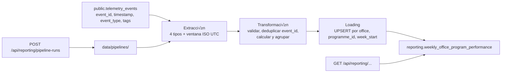

# NEXOVA — BUSINESS REPORTING PIPELINE: DESIGN PHASE

## PHASE 1 — CURRENT STATE ANALYSIS

### Current State

Esta fase se basa en la inspección del árbol de trabajo actual, sus migraciones,
pruebas, contratos de telemetría y, cuando se indica expresamente, el historial
Git. No se ha implementado código, migraciones ni orquestación.

#### Telemetría capturada actualmente

La API FastAPI registra el router `app.telemetry.router` en `app/main.py` y
expone `POST /api/telemetry/events`. El endpoint acepta lotes de envelopes
CloudEvents 1.0, valida por evento los campos de envelope (`id` UUID, `time`,
`source`, `type`, etc.) y proyecta `data` a un conjunto de tags permitido por
tipo. Inserta los eventos v√°lidos en bloque; un evento inv√°lido incrementa
`rejected` sin impedir que se almacenen los dem√°s.

El cat√°logo permitido actualmente enumera los siguientes tipos: eventos de
inventario (`inbound_order_created`, `outbound_order_created`,
`stock_threshold_triggered`, `direct_stock_edit_rejected` y
`kit_cost_variance_detected`), autenticación, infraestructura, frontend,
talento, incidencias y proveedores. El endpoint, sin embargo, no valida la
sem√°ntica ni los campos obligatorios de cada tipo: solo valida el envelope y
descarta de `data` las claves que no estén en el allowlist. Un tipo desconocido
puede superar la validación del envelope y se almacenaría con `tags` vacío.

La telemetría cuenta con productores conectados. En backend,
`TimingMiddleware` emite `api_request_completed` para cada ruta salvo la de
ingesta, y el manejador global de excepciones emite `unhandled_api_error`.
Ambos usan `TelemetryEmitter` y no alteran el flujo de la solicitud si falla
la persistencia. En frontend, el servicio inicializado en el layout emite
eventos de autenticación, ciclo de vida y validación de formularios,
navegación, secciones, errores de renderizado, cambios de proveedores e
incidencias, e inventario desde sus formularios.

`InboundFormPanel` y `OutboundFormPanel` emiten, después del éxito HTTP,
`inbound_order_created` y `outbound_order_created`; a continuación intentan
emitir `stock_threshold_triggered` tras consultar el stock desde frontend. El
backend sigue sin modelo ni trigger de umbrales. No hay emisor de
`kit_cost_variance_detected`.

#### Eventos obligatorios para el informe de negocio

| Evento | Situación comprobada en el código actual | Dimensiones disponibles en el contrato |
|---|---|---|
| `inbound_order_created` | Emitido desde frontend tras crear una entrada; `create_inbound` no lo emite desde el dominio ni queda acoplado transaccionalmente a la telemetría. | `product_id`, `product_sku`, `product_category`, `programme_id`, `quantity`, `supplier`, `office`, `currency`, `unit_cost`, `user_uuid` |
| `outbound_order_created` | Emitido desde frontend tras crear una salida; `create_outbound` no lo emite desde el dominio ni queda acoplado transaccionalmente a la telemetría. | `product_id`, `product_sku`, `product_category`, `programme_id`, `quantity`, `exit_type`, `office`, `user_uuid` |
| `stock_threshold_triggered` | Intentado desde frontend con un umbral no persistido; no hay backend de umbrales ni garantía de generación desde la operación de dominio. | `product_id`, `product_sku`, `product_category`, `office`, `current_stock`, `threshold`, `stock_level` |
| `kit_cost_variance_detected` | Definido en el allowlist, pero no existen catálogo de kits, composición ni cálculo/emisor. | `product_id`, `product_sku`, `product_category`, `kit_composition`, `expected_cost`, `actual_cost`, `variance_percent`, `currency`, `office` |

`docs/telemetry/event-schemas.json` y `docs/telemetry/telemetry-plan.md`
describen los cuatro eventos como contratos de diseño. Dichos documentos son
√∫tiles para conocer el destino previsto de los payloads, pero no sustituyen la
evidencia del código de emisión.

#### Persistencia de telemetría

La persistencia usa exclusivamente `TELEMETRY_DATABASE_URL`; el adaptador
rechaza una URL ausente o que no sea PostgreSQL. El repositorio inserta en
`public.telemetry_events` con `ON CONFLICT (event_id) DO NOTHING`, de modo que
la ingesta repetida del mismo UUID no duplica ese evento. No actualiza ni borra
filas.

La migración `001_create_telemetry_events.sql` define la tabla:

| Columna | Tipo / restricción | Uso |
|---|---|---|
| `id` | `BIGINT` identity, PK | Identificador interno |
| `event_id` | `UUID NOT NULL UNIQUE` | Identificador CloudEvents e idempotencia de ingesta |
| `event_type` | `VARCHAR(100) NOT NULL` | Tipo de evento |
| `timestamp` | `TIMESTAMPTZ NOT NULL` | Momento del hecho |
| `source` | `VARCHAR(255) NOT NULL` | Origen del evento |
| `session_id` | `VARCHAR(100)` | Extensión opcional |
| `schema_version` | `VARCHAR(20)` | Extensión opcional |
| `tags` | `JSONB NOT NULL` | Payload filtrado por allowlist |

Existen índices por `timestamp`, `event_type` y GIN sobre `tags`. La migración
de alineación posterior mantiene esta estructura en el esquema `public`.

#### Pipeline e informe técnico existentes

El árbol de trabajo actual dispone del pipeline técnico
`services/api/app/telemetry/report.py`. Lee `public.telemetry_events` a través
de `TELEMETRY_DATABASE_URL`, filtra opcionalmente por intervalo temporal,
expande el JSONB `tags` con Pandas y compone resultados serializables. Mantiene
una caché en memoria de 60 segundos para la respuesta estructurada.

`app.telemetry.analysis` calcula A1–A5: éxito de login por día, tasa de error
API por ruta, percentiles de latencia por ruta, fallos de validación por
formulario y engagement por sección. `report.py` añade A6–A11: abandono de
formularios, cuentas creadas, coste medio de entradas cuando hay `unit_cost`,
eventos de umbral de stock, variación de tarifa de proveedor y cambios de
estado de incidencias.

El router expone `GET /api/telemetry/report` con `start_date`, `end_date` y
`limit` opcionales; sin período, usa los siete días previos. El frontend lo
consume para el dashboard System Analytics. Este endpoint y pipeline son
técnicos/operativos: no persisten una consolidación semanal de negocio por
oficina y programa, y deben mantenerse sin cambios.

#### Entidades de dominio e inventario relevantes

El módulo `app.inventory` persiste:

| Entidad | Campos relevantes | Observación para reporting |
|---|---|---|
| `Asset` | `id`, `name`, `sku`, `category`, `office` | `category` es texto libre; no hay categoría funcional controlada ni `programme_id`. |
| `AssetEntry` | `asset_id`, `quantity`, `supplier`, `office`, `created_at`, `user_uuid` | Representa entradas; no tiene `unit_cost`, `currency` ni `programme_id`. |
| `AssetExit` | `asset_id`, `quantity`, `exit_type`, `assigned_to`, `office`, `created_at`, `user_uuid` | Representa salidas; no identifica kits entregados ni tiene `programme_id`. |

El stock se deriva de la suma de entradas menos salidas. Las operaciones
`create_inbound` y `create_outbound` son los puntos de negocio relevantes, pero
actualmente no generan eventos. Tampoco hay modelo de umbral de stock,
catálogo/composición de kits, ni modelo de programas. Las oficinas existen como
texto libre en activos y movimientos; el modelo no impone la relación Valencia
‚Üí EUR o Miami ‚Üí USD.

### Business Reporting Gap

El diseño técnico existente responde preguntas operativas y de salud del
sistema: distribución de eventos, éxito de login, tasa/latencia de API,
interacciones de formularios, engagement, coste medio de entradas cuando
existiese `unit_cost`, alertas de stock y cambios de tarifa/proveedor. No era
una consolidación semanal de negocio por oficina y programa.

El informe de negocio solicitado necesita una fila por
`(office, programme_id, week_start)` y debe contestar, sin mezclar monedas:

1. cuánto material adquirió cada oficina para cada programa;
2. cu√°ntos kits se entregaron;
3. cuántas veces el stock del programa cayó bajo su mínimo; y
4. cuántas variaciones anómalas de coste de material se detectaron.

Estas respuestas requieren una fuente de eventos de negocio completa y con
dimensiones consistentes, adem√°s de una salida persistida separada. No deben
reemplazar las métricas técnicas ni almacenarse en `telemetry_events`.

#### Información faltante o no operativa

| Necesidad | Estado actual | Consecuencia |
|---|---|---|
| Emisión de los cuatro eventos obligatorios | Inbound, outbound y el intento de umbral se emiten desde frontend; la variación de coste de kit no se emite. | La fuente es incompleta; para KPI fiables, la emisión y sus dimensiones deben quedar garantizadas desde el dominio o mediante una garantía de entrega aprobada. |
| `programme_id` | Solo aparece como campo opcional de contrato; no existe en `Asset`, `AssetEntry` ni `AssetExit`. | No es posible agrupar de forma verificable por programa. |
| `unit_cost` y `currency` en entradas | El contrato los prevé, pero `AssetEntry` no los persiste. | No se puede calcular coste de adquisición ni validar EUR/USD desde la fuente real. |
| Identificación de kit entregado | Una salida tiene cantidad y `exit_type`, pero no representa un kit ni su composición. | No es posible definir con evidencia el conteo de kits entregados. |
| Umbral por producto/oficina | No existe backend ni modelo de umbrales. | No se puede emitir ni contar `stock_threshold_triggered`. |
| Coste esperado/real y composición de kit | No existe modelo ni cálculo. | No se puede emitir ni contar `kit_cost_variance_detected`. |
| Ruta del informe técnico | Existe como `GET /api/telemetry/report`, con el prefijo `/api` de FastAPI. | El briefing lo nombra sin prefijo; las nuevas rutas deben respetar la convención real o requerir confirmación. |

### Evidencia revisada

- `data/pipelines/README.md`
- `services/README.md` y `services/api/README.md`
- `CONTEXT.es.md` y los cuatro archivos obligatorios de `memory-bank/`
- `services/api/app/main.py`
- `services/api/app/telemetry/{models.py,router.py,repository.py,tags.py,emitter.py,analysis.py,report.py}`
- `services/api/app/middleware/timing.py`
- `services/api/app/inventory/{models.py,operations.py,router.py,queries.py,schemas.py}`
- `uis/backoffice/talent-pipeline-tracker/{components,hooks,lib}/` (emisores de
  telemetría e integración del informe técnico)
- `services/api/scripts/migrations/{001_create_telemetry_events.sql,002_align_existing_telemetry_events.sql}`
- `services/api/tests/{test_telemetry_models.py,test_telemetry_router.py,test_telemetry_repository.py}`
- `docs/telemetry/{telemetry-plan.md,event-schemas.json}`

## PHASE 2 — BUSINESS PIPELINE DESIGN

**Propósito:** producir la consolidación semanal de rendimiento de negocio por
oficina y programa para el reporting ejecutivo de Nexova, calculando coste de
adquisición de material, kits entregados, frecuencia de faltas de stock y
frecuencia de variaciones anómalas de coste de material desde telemetría.

### 2.1. Propósito de negocio y cadencia

El entregable es una tabla de KPI semanales con una fila por
`office`, `programme_id` y `week_start`. Sus cuatro métricas son:

| KPI | Definición |
|---|---|
| `total_material_cost` | Suma de `quantity √ó unit_cost` de las entradas de material v√°lidas. |
| `kits_delivered_count` | N√∫mero de eventos `outbound_order_created` v√°lidos que representan una entrega de kit. |
| `shortage_events_count` | N√∫mero de eventos `stock_threshold_triggered` v√°lidos. |
| `cost_variance_events_count` | N√∫mero de eventos `kit_cost_variance_detected` v√°lidos. |

El período es una semana ISO en UTC: comienza el lunes a las `00:00:00Z` y
termina el lunes siguiente a las `00:00:00Z` (límite superior exclusivo).
`week_start` es la fecha UTC del lunes inicial. La ejecución es semanal y debe
publicar la semana recién cerrada. Se propone, pendiente de aprobación
operativa, ejecutarla a las **00:15 UTC de cada lunes**; la hora no se considera
aprobada por este diseño.

Una ejecución manual recibirá un `week_start` de lunes ISO y recalculará por
completo esa semana. Esto incorpora eventos tardíos; el mecanismo de
reescritura idempotente se concreta en la fase 3. La corrección semántica de un
evento ya registrado queda pendiente de una política de negocio explícita.

### 2.2. Fuente y formato de extracción

La fuente primaria y única para las métricas es
`public.telemetry_events`; no se consulta `AssetEntry` ni `AssetExit` como
segunda fuente de cálculo. La extracción selecciona por `timestamp >= :start`
y `timestamp < :end`, y por estos cuatro `event_type`:

| Evento | Campos requeridos del envelope | Payload `tags` requerido para el pipeline |
|---|---|---|
| `inbound_order_created` | `event_id`, `timestamp`, `event_type` | `office`, `programme_id`, `quantity`, `unit_cost`, `currency`; se conservan `product_id`, `product_sku`, `supplier` para trazabilidad. |
| `outbound_order_created` | Igual | `office`, `programme_id`, `quantity`, `exit_type`; se conserva `product_category` solo para trazabilidad, no como filtro de la KPI. |
| `stock_threshold_triggered` | Igual | `office`, **`programme_id`**, `product_id`, `threshold`, `current_stock`, `stock_level`. |
| `kit_cost_variance_detected` | Igual | `office`, **`programme_id`**, `currency`, `expected_cost`, `actual_cost`, `variance_percent`, `product_id` o `product_sku`. |

`programme_id` ya est√° permitido para inbound y outbound, pero no se emite en
los formularios actuales. Debe hacerse obligatorio en los cuatro eventos de
negocio; para los dos últimos es una extensión aditiva del allowlist y del
contrato actual. `unit_cost` y `currency` deben emitirse en las entradas como
valores no nulos y v√°lidos. Ninguna de estas extensiones se implementa en este
hito.

La moneda de salida se asigna de forma determinista desde la oficina canónica:
`Valencia` ‚Üí `EUR`; `Miami` ‚Üí `USD`. El pipeline acepta √∫nicamente esos valores
exactos de oficina; rechaza variantes no canónicas. Cuando un payload contiene
`currency`, la valida contra ese mapa, pero no depende de que exista una entrada
para asignar moneda: una semana con solo salidas, faltas de stock o variaciones
genera igualmente su fila con la moneda de la oficina. No convierte ni combina
monedas. Los identificadores de programa no existen a√∫n, por lo que no se
inventan valores de ejemplo.

### 2.3. Flujo de datos



### 2.4. Estrategia de extracción

La tarea de extracción recibe `week_start`, deriva `start` y `end` en UTC y
lee solo la ventana indicada. Recupera `event_id`, `event_type`, `timestamp` y
`tags`; aplica el filtro de tipos en SQL y ordena por `timestamp, event_id`.
`event_id` es el identificador de deduplicación: ante registros repetidos se
conserva una sola ocurrencia determinista por UUID antes de agregar.

El tiempo de negocio se basa exclusivamente en `timestamp`, no en la hora de
ingesta. Los eventos tardíos que pertenezcan a una semana cerrada se incorporan
cuando se recalcule esa semana mediante el disparo manual. Una reejecución
programada o manual relee la ventana completa, por lo que los eventos tardíos
no se suman incrementalmente sobre un resultado anterior.

### 2.5. Estrategia de transformación

La transformación valida el tipo de datos, dimensiones obligatorias y la
coherencia oficina-moneda antes de agrupar. Cada rechazo se contabiliza para
observabilidad posterior y no contribuye a ning√∫n KPI.

| KPI | Regla de c√°lculo exacta |
|---|---|
| `total_material_cost` | Para cada inbound único y válido: `Decimal(quantity) × Decimal(unit_cost)`. Se suma solo dentro de la misma combinación `office`, `programme_id`, `currency`, `week_start`. |
| `kits_delivered_count` | Cuenta uno por cada `outbound_order_created` √∫nico y v√°lido; no usa `quantity`, conforme al requisito de contar eventos de salida. No filtra por `product_category`. |
| `shortage_events_count` | Cuenta uno por cada `stock_threshold_triggered` √∫nico, v√°lido y atribuido a oficina/programa. |
| `cost_variance_events_count` | Cuenta uno por cada `kit_cost_variance_detected` √∫nico, v√°lido y atribuido a oficina/programa. |

Las combinaciones que solo tengan contadores, pero ning√∫n inbound v√°lido,
producen `total_material_cost = 0` y reciben la moneda del mapa de oficina. Los
eventos con UUID duplicado, campos ausentes, cantidad no positiva, coste
negativo/no numérico o moneda presente e incoherente se rechazan. Esta regla
evita que un reintento de envío o un payload incompleto infle los resultados.

La corrección posterior de un hecho de negocio no está definida en el contrato
actual: `event_id` y `ON CONFLICT DO NOTHING` cubren reintentos técnicos del
mismo evento, pero no establecen qué hacer ante un evento ya registrado con un
dato de negocio incorrecto. La política de corrección es una decisión pendiente
de negocio; hasta que se apruebe, el recálculo semanal incorpora eventos tardíos
pero no interpreta un segundo UUID como sustitución de otro.

El resultado intermedio queda normalizado a la clave
`(office, programme_id, week_start, currency)`, donde `currency` procede del
mapa de oficina. Como una oficina solo puede tener una moneda v√°lida en v1, se
proyecta después a la fila de destino `(office, programme_id, week_start)` sin
sumar EUR con USD.

### 2.6. Estrategia de carga

El destino es exactamente:
`reporting.weekly_office_program_performance`.

Su clave √∫nica `unique (office, programme_id, week_start)` define el grano y
permite un `INSERT ... ON CONFLICT (office, programme_id, week_start) DO
UPDATE`. La carga escribe los cuatro KPI, `currency` y `computed_at` a partir
de la agregación completa y determinista de una semana; nunca escribe datos de
negocio en `telemetry_events`.

Las tablas de ejecución que permitirán registrar rechazos y estado se diseñan
en la fase 3 bajo el esquema `reporting`. No se propone ninguna tabla adicional
para cambiar el c√°lculo de KPI en esta fase.

### 2.7. Endpoints de business reporting

El módulo propuesto es `services/reporting/`, independiente de
`services/telemetry/`, y respeta la convención real de rutas `/api`:

| Ruta | Responsabilidad | Relación con pipeline y tablas |
|---|---|---|
| `GET /api/reporting/weekly-office-program-performance?week_start=YYYY-MM-DD` | Devuelve todas las combinaciones de la semana solicitada; sin par√°metro, usa la √∫ltima semana calculada disponible. | Lee `reporting.weekly_office_program_performance`; no ejecuta ETL. |
| `GET /api/reporting/pipeline-runs/latest` | Devuelve estado y metadatos de la última ejecución del pipeline de negocio. | Lee el historial de ejecuciones de `reporting`; no ejecuta ETL. |
| `POST /api/reporting/pipeline-runs` | Solicita una ejecución manual, opcionalmente para un `week_start` ISO válido. | Invoca el punto de entrada del flujo en `data/pipelines/`; el flujo lee telemetría y carga las tablas `reporting`. |

El primer endpoint responde `week_start` y una lista de entradas con `office`,
`programme_id`, los cuatro KPI y `currency`. El servicio solo valida el
parámetro, consulta o dispara el flujo: no contiene extracción, transformación,
agregación ni carga. `GET /api/telemetry/report` permanece intacto.

## PHASE 3 — RESILIENCE AND IDEMPOTENCY

El pipeline debe ser idempotente, observable y recuperable. Estas propiedades
son requisitos de diseño para el flujo de negocio, no características heredadas
automáticamente de la ingesta de telemetría.

### 3.1. Idempotencia

La idempotencia opera en dos niveles:

1. **Evento:** la extracción elimina reintentos exactos por `event_id`, que ya
   es √∫nico en `telemetry_events`.
2. **Resultado semanal:** la tabla de destino usa
   `unique (office, programme_id, week_start)` y se carga con PostgreSQL:

```sql
insert into reporting.weekly_office_program_performance (
  office, programme_id, week_start, total_material_cost,
  kits_delivered_count, shortage_events_count,
  cost_variance_events_count, currency, computed_at
)
values (...)
on conflict (office, programme_id, week_start) do update set
  total_material_cost = excluded.total_material_cost,
  kits_delivered_count = excluded.kits_delivered_count,
  shortage_events_count = excluded.shortage_events_count,
  cost_variance_events_count = excluded.cost_variance_events_count,
  currency = excluded.currency,
  computed_at = excluded.computed_at;
```

El `DO UPDATE` reemplaza una agregación completa y determinista; nunca suma el
resultado nuevo sobre los valores ya almacenados. Así, relanzar la misma semana
produce una única fila correcta por oficina/programa, no una acumulación.

`event_id` resuelve el problema técnico de reintentar la inserción del mismo
evento. No resuelve, ni debe reinterpretar por sí solo, una corrección de
negocio registrada después con otro UUID. El contrato actual no define una
política de corrección, sustitución o compensación de eventos; decidirla
requiere aprobación de negocio. Hasta entonces, la idempotencia garantizada se
limita a reintentos exactos y el pipeline no añadirá campos de payload ni
mecanismos de compensación por iniciativa propia.

#### Escenario de fallo durante la carga

1. El flujo extrae y transforma la semana `2026-07-13`.
2. Comienza a cargar sus combinaciones oficina/programa.
3. Tras persistir Valencia/programa A y Miami/programa B, falla antes de las
   restantes combinaciones (por ejemplo, si una ejecución previa emplease
   lotes confirmados individualmente).
4. La ejecución se marca `failed`, conservando su error y sus contadores.
5. Se vuelve a ejecutar la semana completa.
6. Los upserts actualizan Valencia/programa A y Miami/programa B con la
   agregación recalculada; las combinaciones restantes se insertan.
7. El resultado final contiene exactamente una fila por
   oficina/programa/semana, con KPI calculados desde el conjunto de eventos
   deduplicado.

La implementación principal debe enviar todos los upserts de una ejecución en
una única transacción de PostgreSQL: si falla antes del commit, ningún resultado
de esa transacción queda visible. El escenario anterior sigue siendo recuperable
si existe una carga parcial histórica, una interrupción entre lotes o una
operación manual; el upsert evita duplicados, y el recálculo total evita el
doble conteo.

### 3.2. Observabilidad y registro de ejecuciones

Se propone una tabla reutilizable en el esquema `reporting`:

```sql
create table reporting.pipeline_runs (
  id uuid primary key default gen_random_uuid(),
  pipeline_name text not null,
  week_start date not null,
  started_at timestamptz not null default now(),
  finished_at timestamptz,
  status text not null check (status in ('running', 'completed', 'failed')),
  records_processed integer not null default 0,
  records_inserted integer not null default 0,
  records_updated integer not null default 0,
  records_rejected integer not null default 0,
  error_message text,
  trigger_type text not null check (trigger_type in ('scheduled', 'manual')),
  requested_at timestamptz not null default now()
);

create index idx_reporting_pipeline_runs_latest
  on reporting.pipeline_runs (pipeline_name, started_at desc);
```

| Campo | Tipo | Justificación |
|---|---|---|
| `id` | `uuid` | Identifica una ejecución concreta y permite correlacionar logs. |
| `pipeline_name` | `text` | Distingue este flujo de futuros pipelines reutilizando la misma tabla. |
| `week_start` | `date` | Expone inequívocamente el período de reporting procesado. |
| `started_at` / `finished_at` | `timestamptz` | Permiten conocer duración, ejecuciones en curso y momento de finalización. |
| `status` | `text` controlado | Expresa los estados operativos `running`, `completed` y `failed`. |
| `records_processed` | `integer` | Mide los eventos de fuente considerados antes de la agregación. |
| `records_inserted` / `records_updated` | `integer` | Distinguen el efecto de carga y hacen visible una recuperación parcial. |
| `records_rejected` | `integer` | Cuantifica eventos inv√°lidos o incompletos excluidos de las KPI. |
| `error_message` | `text` nullable | Conserva un mensaje operativo saneado cuando el flujo falla. |
| `trigger_type` | `text` controlado | Diferencia ejecución programada de recálculo manual. |
| `requested_at` | `timestamptz` | Separa el instante de solicitud del inicio efectivo de trabajo. |

El `GET /api/reporting/pipeline-runs/latest` consulta la √∫ltima fila para
`pipeline_name = 'weekly_office_program_performance'`, no la tabla de KPI. Por
eso el historial de ejecución y la salida de negocio siguen siendo entidades
distintas.

### 3.3. Recuperabilidad

Los límites transaccionales separan explícitamente el historial del resultado:

1. Se inserta y confirma la fila `running` en `reporting.pipeline_runs`.
2. La carga de `reporting.weekly_office_program_performance` se realiza en una
   segunda transacción, que contiene todos sus upserts.
3. Tras su commit, una transacción independiente actualiza la ejecución a
   `completed`, con `finished_at` y contadores.
4. Si falla extracción, transformación o carga, se revierte solo la transacción
   de salida; en una transacción nueva e independiente se actualiza la fila ya
   confirmada a `failed`, con `finished_at` y un mensaje saneado.

Así el rollback de resultados no puede borrar el registro de fallo. La siguiente
ejecución no usa un checkpoint de filas: vuelve a extraer, validar, deduplicar
y agregar toda la semana indicada.

La √∫ltima semana completada puede obtenerse como la √∫ltima fila `completed` de
este pipeline, pero es metadato de ejecución, no una fuente alternativa de
KPI. No se necesita complejidad de checkpoints porque la agregación semanal
completa es acotada y reproducible desde `telemetry_events`.

Los reintentos autom√°ticos solo ser√°n apropiados para fallos transitorios de
conexión; deben crear o actualizar un registro de ejecución trazable y no
ocultar el error final. Los eventos tardíos se recuperan mediante un backfill
manual de `week_start`; el upsert reemplaza la fila semanal. Las correcciones
semánticas de eventos quedan sujetas a la política de negocio pendiente y no se
resuelven mediante una interpretación implícita de UUID distintos.

## PHASE 4 — PREFECT MAPPING

La inspección de `services/api/pyproject.toml`, `requirements.txt`, `uv.lock`,
`docker-compose.yml`, `infra/` y `data/pipelines/` no encuentra Prefect ni una
configuración de orquestación existente. Por tanto, este apartado es un mapeo
de diseño: no presupone que Prefect esté instalado, desplegado o configurado.

### Flujo principal

El flujo principal propuesto es:

```text
weekly_office_program_performance_flow(week_start: date, trigger_type: str)
```

Recibe un lunes ISO UTC y el origen (`scheduled` o `manual`). Si una ejecución
programada no recibe fecha, calcula el lunes de la semana ISO recién cerrada.
Primero abre un registro `running`; después encadena las tres tareas siguientes
y finalmente actualiza el registro a `completed` o `failed`. La lógica ETL vive
en `data/pipelines/`; los servicios solo solicitan o consultan el flujo.

| Tarea Prefect | Responsabilidad | Entrada | Salida | Relación |
|---|---|---|---|---|
| `extract_telemetry_events` | Lee de `public.telemetry_events` los cuatro tipos de negocio en la ventana `[week_start, next_week_start)`. | `week_start`, conexión PostgreSQL y tipos permitidos. | Eventos fuente normalizados con `event_id`, `timestamp`, `event_type` y `tags`. | Alimenta la transformación; no escribe resultados. |
| `transform_weekly_office_program_performance` | Valida, deduplica reintentos exactos y calcula las KPI por oficina/programa/semana/moneda. | Eventos extraídos y `week_start`. | Filas agregadas listas para destino, más contadores de procesados y rechazados. | Consume extracción y entrega una agregación determinista a carga. |
| `load_weekly_office_program_performance` | Ejecuta los upserts transaccionales y devuelve el efecto de carga. | Filas agregadas, `week_start` y conexión PostgreSQL. | Conteos de insertadas/actualizadas y hora de cómputo. | Escribe solo en `reporting.weekly_office_program_performance`; actualiza la ejecución al finalizar el flujo. |

La creación y actualización de `reporting.pipeline_runs` pueden ser helpers del
flujo, no una cuarta tarea de transformación. Así el registro envuelve toda la
ejecución y sigue disponible aunque falle una de las tres tareas principales.

### Estados y recuperación

| Estado Prefect | Uso en este flujo | Efecto operativo |
|---|---|---|
| `Running` | El flow y cada tarea activa están procesando el período. | La ejecución correspondiente permanece `running` en `reporting.pipeline_runs`. |
| `Completed` | Extracción, transformación y carga concluyen correctamente. | Se confirma la transacción de resultados y la ejecución queda `completed` con contadores y `finished_at`. |
| `Failed` | Una tarea agota su reintento o surge un error no recuperable. | Se registra `failed`, el mensaje saneado y `finished_at`; una reejecución recalcula la semana completa. |

Los reintentos se limitar√°n a fallos transitorios de conectividad con PostgreSQL
o el servicio de orquestación. No deben reintentar automáticamente eventos
inválidos: estos se contabilizan como rechazados. La información de estado de
Prefect complementa, pero no sustituye, el historial persistente de
`reporting.pipeline_runs` que consumir√° la API.

### Configuración y credenciales mediante Prefect Blocks

| Block / configuración | Contenido | Uso y restricción |
|---|---|---|
| Block de credenciales PostgreSQL/Supabase | URL privada o campos de conexión, SSL y nombre de base. | Da acceso de lectura a `public.telemetry_events` y de escritura a `reporting`; nunca se expone mediante `NEXT_PUBLIC_*` ni se almacena en el repositorio. |
| Block de variables de reporting | Nombre de flujo, tipos de evento, oficinas permitidas, regla oficina-moneda, hora propuesta y política de reintentos. | Separa configuración operativa del código del flujo; la hora semanal sigue pendiente de aprobación. |
| Block de notificación (futuro) | Destino y credenciales de alertas de fallo. | Puede avisar de `Failed`; no es requisito para la primera implantación. |
| Block de infraestructura / work pool | Imagen, entorno y mecanismo de ejecución del worker. | Debe definirse cuando se elija dónde se despliega Prefect; no hay worker ni pool existentes en el repositorio. |

Al introducir Prefect en un hito posterior ser√° necesario decidir e instalar la
dependencia, crear el deployment/worker, conceder privilegios mínimos sobre el
esquema `reporting` y registrar los Blocks fuera del código. Nada de ello se
implementa en esta fase.

## PHASE 5 — APPLICATION INTEGRATION (DESIGN ONLY)

### Módulo y límite arquitectónico

Se propone el nuevo módulo HTTP `services/reporting/`. Será independiente de
`services/telemetry/` y no modificar√° `services/telemetry/analysis.py` ni
`GET /api/telemetry/report`. Cuando se integre con la aplicación FastAPI
existente, su router se registrar√° bajo el prefijo real `/api/reporting`.

La dirección de dependencias es obligatoria:

```text
services/reporting/  ‚Üí  data/pipelines/  ‚Üí  PostgreSQL
```

`services/reporting/` podr√° validar solicitudes, consultar las tablas del
esquema `reporting` y solicitar una ejecución; no podrá extraer eventos,
validarlos, transformarlos, agruparlos ni cargarlos. Esas responsabilidades
pertenecen exclusivamente al flujo de `data/pipelines/`.

Para la futura integración, `data/pipelines/` expondrá el punto de entrada
`trigger_weekly_office_program_performance_flow(week_start, trigger_type)`.
Ese adaptador dispara el deployment Prefect de
`weekly_office_program_performance_flow`; no replica sus tareas ni contiene
lógica de KPI. El nombre se define aquí como contrato de integración, no como
código existente.

### Endpoints

| Endpoint | Propósito | Integración con el pipeline |
|---|---|---|
| `GET /api/reporting/weekly-office-program-performance` | Consulta las KPI semanales de negocio. | Lee la salida materializada; no inicia ejecución. |
| `GET /api/reporting/pipeline-runs/latest` | Consulta el último intento del pipeline. | Lee el historial de ejecuciones; no inicia ejecución. |
| `POST /api/reporting/pipeline-runs` | Solicita un c√°lculo o rec√°lculo manual. | Llama al adaptador del flujo en `data/pipelines/`; no ejecuta ETL en HTTP. |

#### `GET /api/reporting/weekly-office-program-performance`

| Aspecto | Diseño |
|---|---|
| Par√°metro | `week_start` opcional, fecha ISO `YYYY-MM-DD` que debe ser lunes. |
| Comportamiento sin par√°metro | Selecciona el `week_start` m√°s reciente disponible en `reporting.weekly_office_program_performance`. |
| Consulta | Filtra la tabla por `week_start`, ordena por `office, programme_id` y no consulta `telemetry_events`. |
| Éxito | `200 OK`; devuelve la semana y todas sus combinaciones oficina/programa. |
| Sin resultados | `404 Not Found` con un mensaje de que no hay c√°lculo disponible para esa semana. |
| Responsabilidad del módulo | Validar fecha, ejecutar una consulta de lectura y serializar el resultado. |

Respuesta prevista:

```json
{
  "week_start": "2026-07-13",
  "entries": [
    {
      "office": "Valencia",
      "programme_id": "<programme_id_real>",
      "total_material_cost": 1240.50,
      "kits_delivered_count": 18,
      "shortage_events_count": 1,
      "cost_variance_events_count": 0,
      "currency": "EUR"
    }
  ]
}
```

`<programme_id_real>` es un marcador documental: el dominio actual no define
identificadores de programa y este diseño no inventa uno.

#### `GET /api/reporting/pipeline-runs/latest`

| Aspecto | Diseño |
|---|---|
| Par√°metros | Ninguno en v1. |
| Consulta | Obtiene la fila m√°s reciente de `reporting.pipeline_runs` para `pipeline_name = 'weekly_office_program_performance'`, ordenada por `started_at DESC`. |
| Éxito | `200 OK` con estado, período, timestamps, contadores y mensaje de error saneado si existe. |
| Sin ejecuciones | `404 Not Found`; todavía no existe historial. |
| Responsabilidad del módulo | Solo consulta historial; no infiere KPI ni modifica el estado. |

Respuesta prevista:

```json
{
  "id": "9a5c37cb-58b9-4f83-a39a-3cb359c61e18",
  "pipeline_name": "weekly_office_program_performance",
  "week_start": "2026-07-13",
  "status": "completed",
  "started_at": "2026-07-21T00:15:02Z",
  "finished_at": "2026-07-21T00:15:07Z",
  "records_processed": 96,
  "records_inserted": 3,
  "records_updated": 0,
  "records_rejected": 2,
  "error_message": null,
  "trigger_type": "scheduled"
}
```

#### `POST /api/reporting/pipeline-runs`

| Aspecto | Diseño |
|---|---|
| Cuerpo opcional | `{ "week_start": "YYYY-MM-DD" }`; si se omite, el adaptador calcula la √∫ltima semana ISO cerrada. La fecha proporcionada debe ser lunes. |
| Función importada | `data.pipelines.weekly_office_program_performance.trigger_weekly_office_program_performance_flow`. |
| Comportamiento | Valida la solicitud y llama al adaptador con `trigger_type="manual"`. El adaptador crea/solicita la ejecución Prefect; el endpoint no procesa eventos. |
| Éxito | `202 Accepted`, con el identificador de ejecución, semana solicitada y estado inicial `running` o `scheduled`, según la respuesta del orquestador. |
| Error de validación | `422 Unprocessable Entity` para una fecha inválida o que no sea lunes. |
| Error de orquestación | `503 Service Unavailable` si no se puede solicitar Prefect, sin exponer credenciales ni detalles internos. |
| Datos implicados | El flujo leer√° `public.telemetry_events` y escribir√° `reporting.weekly_office_program_performance` y `reporting.pipeline_runs`; el router no lo hace directamente. |

Respuesta prevista:

```json
{
  "run_id": "9a5c37cb-58b9-4f83-a39a-3cb359c61e18",
  "pipeline_name": "weekly_office_program_performance",
  "week_start": "2026-07-13",
  "status": "scheduled",
  "trigger_type": "manual"
}
```

Este endpoint permite un backfill explícito de una semana previa y conserva la
separación de capas: HTTP solicita; Prefect orquesta; las tareas del pipeline
calculan; PostgreSQL materializa y registra. No se ha creado el módulo, el
router, las tablas, las importaciones ni el deployment en este hito de diseño.


## Phase 5 implementation status ó CLI and HTTP reporting

The CLI is exposed as `main(argv=None)` and remains runnable from the repository
root with `uv run --project services/api python data/pipelines/pipeline.py`.
Use `--week-start YYYY-MM-DD` for an explicit ISO-week Monday and
`--trigger-type manual|scheduled` to label the run. With no week, the flow
selects the most recently closed ISO week. The command does not configure a
scheduler by itself.

The approved cadence is Mondays at 00:15 UTC. This is a scheduling decision,
not an active Prefect schedule: an operator must configure the self-hosted
Prefect deployment/work pool and its schedule. The API's manual trigger asks
the configured Prefect deployment to run; it does not execute the ETL inside
the FastAPI worker. `REPORTING_PREFECT_DEPLOYMENT` can override the default
`weekly-office-program-performance/weekly-office-program-performance` name.

The authenticated `/api/reporting` router provides the latest persisted run,
manual run requests (administrator only), and read-only weekly KPI filters.
Storage uses `REPORTING_DATABASE_URL`; it returns 503 when configuration,
PostgreSQL, or the Prefect deployment is unavailable. No live DB migration or
Prefect deployment was performed as part of this implementation.
