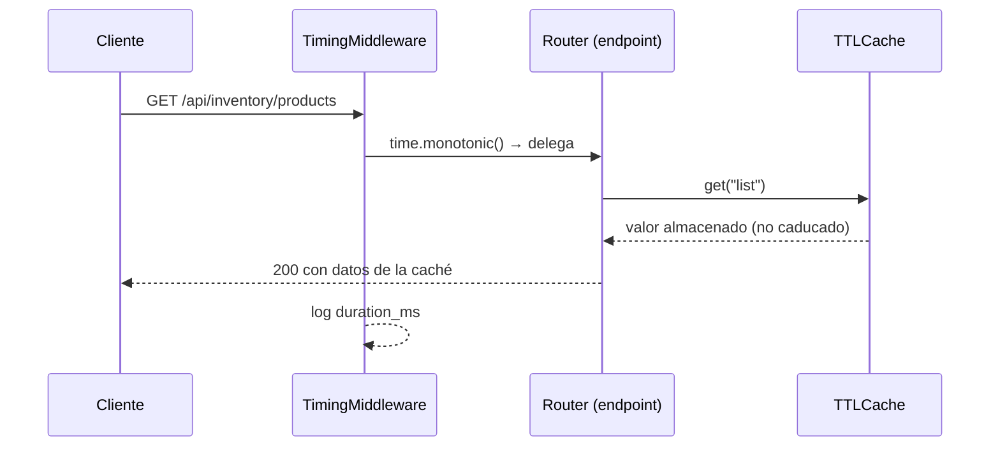
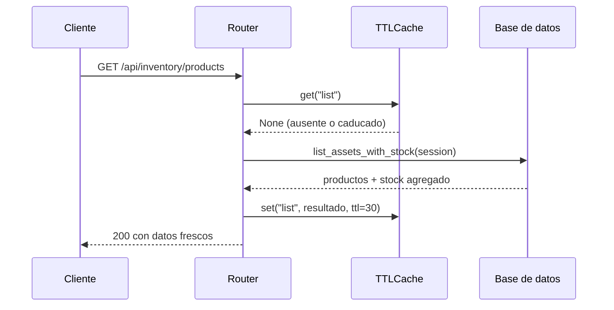

# Aprendiendo: caché y optimización de rendimiento en Nexova

Guía didáctica sobre los conceptos de caching y sobre el proceso real seguido para
implementarlos en el proyecto Nexova (fases 1 a 8 de la rama
`feature/caching-optimisation`).

## Estado final

- **Medición del rendimiento**: `TimingMiddleware` registra método, ruta, estado y
  duración de cada petición HTTP (`services/api/app/middleware/timing.py`).
- **Caché reutilizable**: clase `TTLCache` (`services/api/app/cache/ttl_cache.py`)
  con expiración por TTL (*Time To Live*), usada en dos endpoints:
  - `GET /api/inventory/products` → TTL 30 s.
  - `GET /api/incidents/summary` → TTL 10 s.
- **Frontend**: carga diferida de `Modal` y `NoteSection` con `next/dynamic`, y
  tres memorizaciones con `useMemo` en el formulario de salidas de inventario.
- **Validación**: 32 tests de caché en backend (`18 + 7 + 7`), suite completa con
  **411 passed, 1 skipped, 4 failed** (los 4 fallos son preexistentes y ajenos a
  este trabajo); frontend con **70 tests en verde** y build de **18 páginas sin
  errores de TypeScript**.
- **Comparación con/sin caché**: la mejora más clara está en los **tiempos
  máximos** (products 133,62 → 16,90 ms; summary 24,81 → 9,12 ms); las medianas
  quedan empatadas dentro del ruido. Detalle en `docs/CACHING_REPORT.md`.

---

## 1. Introducción al caching

### ¿Qué es la caché y qué problema resuelve?

Una **caché** es una copia de datos guardada en un lugar de acceso rápido (casi
siempre la memoria del proceso) para no tener que volver a calcularlos o
buscarlos cada vez que se necesiten.

Ejemplo cotidiano: si cada vez que quieres saber la temperatura de la calle
llamases por teléfono a una estación meteorológica, tardarías mucho en cada
consulta. Si en cambio guardas la última temperatura leída durante unos minutos,
respondes al instante. La caché funciona igual: guarda el resultado de un cálculo
caro durante un tiempo limitado.

El problema que resuelve es el **coste repetido**: consultas a bases de datos,
agregaciones, llamadas a servicios externos o cálculos que se repiten con los
mismos datos de entrada.

### ¿Por qué puede mejorar el rendimiento?

Porque leer de memoria es órdenes de magnitud más rápido que acceder a una base
de datos. En Nexova, la petición `GET /api/inventory/products` agrega el stock de
cada producto sumando sus movimientos; si esa agregación se repite en cada
petición, se paga ese coste muchas veces sin necesidad.

### ¿Cuándo tiene sentido usarla y cuándo no?

Tiene sentido cuando:

- Los datos se leen mucho más veces de lo que se escriben.
- El coste de obtener los datos es notable frente al coste de servirlos.
- Un pequeño retraso en reflejar cambios es aceptable.

**No** hace falta (o puede ser contraproducente) cuando:

- Los datos cambian constantemente y la caché estaría casi siempre obsoleta.
- Los datos son de un solo uso y no se repetirán.
- El conjunto de datos es diminuto y la consulta ya es de pocos milisegundos
  (caso del dataset actual de Nexova: la caché apenas reduce la mediana, como se
  vio en la fase 8).
- La lógica de invalidación se complica tanto que introduce más fallos de los
  que evita.

### ¿Memoria temporal o consultar directamente la fuente?

| | Caché en memoria | Consulta directa |
|---|---|---|
| Velocidad | Muy rápida | Depende de la fuente |
| Frescura | Retrasada hasta el TTL o la invalidación | Siempre actualizada |
| Coste por petición | Casi constante | Crece con los datos |
| Complejidad | Hay que gestionar expiración e invalidación | Ninguna adicional |

### ¿Qué riesgos introduce?

El riesgo principal es la **obsolescencia**: si los datos originales cambian y la
caché no se entera, la aplicación responderá con información vieja. Ejemplo en
Nexova: si se registra una salida de inventario y la caché de productos no se
invalida, el backoffice seguiría mostrando el stock anterior hasta que expire el
TTL. Por eso la caché siempre se combina con **invalidación explícita** en los
puntos de escritura.

Otros riesgos: consumo de memoria (se mitiga con TTL), resultados difíciles de
reproducir durante las pruebas y la tentación de **interpretar como mejora lo que
es solo ruido de medición**.

---

## 2. Conceptos técnicos aplicados

### Caché en memoria

Un diccionario dentro del proceso de la API: clave → valor con fecha de caducidad.
En Nexova vive en `services/api/app/cache/ttl_cache.py`. No requiere servicios
externos (sin Redis) ni dependencias nuevas: se pierde al reiniciar el proceso,
que es aceptable porque es solo un acelerador de lectura.

### TTL (*Time To Live*, tiempo de vida)

Los segundos que una entrada permanece válida. Al leer, `TTLCache.get` compara la
hora de caducidad con `time.monotonic()` y, si ha pasado, devuelve `None` y
elimina la entrada:

```python
# services/api/app/cache/ttl_cache.py
def get(self, key: str) -> T | None:
    entry = self._store.get(key, _NOT_FOUND)
    if entry is _NOT_FOUND:
        return None
    expires_at, value = entry
    if time.monotonic() >= expires_at:
        del self._store[key]
        return None
    return value
```

Se usan **valores distintos** porque los datos tienen distinta sensibilidad y
coste:

- **30 s** en productos: el inventario cambia por operaciones de entrada/salida y,
  además, hay invalidación en cada escritura; el TTL es una red de seguridad
  adicional.
- **10 s** en el resumen de incidencias: es un agregado que el panel de gestión
  refresca con frecuencia; un TTL más corto reduce la ventana de obsolescencia.

### Caché fría y caché caliente

- **Fría**: vacía o recién poblada; la primera petición paga el coste completo de
  la fuente de datos (*cache miss*).
- **Caliente**: con la entrada ya almacenada; las peticiones siguientes la usan
  (*cache hit*).

En la fase 8 se midieron ambas condiciones por separado.

### Invalidación de caché

Borrar una entrada cuando los datos originales cambian, para que la siguiente
lectura vuelva a la fuente. `TTLCache.invalidate(prefix)` elimina todas las claves
que empiecen por un prefijo:

```python
# services/api/app/inventory/router.py (escrituras)
_products_cache.invalidate("list")   # POST producto, entrada y salida
```

Puntos de invalidación reales:

| Dato | Escritura | Punto |
|---|---|---|
| Productos | crear producto / entrada / salida | `app/inventory/router.py` (3 sitios) |
| Resumen | crear incidencia / cambiar estado | `app/incidents/manager_router.py` (2 sitios) |

### Consistencia caché ↔ datos originales

La estrategia combinada en Nexova es: **TTL corto + invalidación en cada
escritura**. La invalidación garantiza inmediatezas en los caminos conocidos de
escritura; el TTL cubre los caminos no previstos (por ejemplo, escrituras
directas en la base de datos fuera de la API). La estrategia inversa (solo TTL)
dejaría una ventana de datos obsoletos; solo invalidación dejaría la caché
expuesta a olvidos futuros.

### Middleware de medición del tiempo de respuesta

Un **middleware** ASGI es una capa que envuelve a la aplicación y observa cada
petición. `TimingMiddleware` toma el instante inicial, deja pasar la petición y,
en el bloque `finally`, calcula y registra la duración:

```python
# services/api/app/middleware/timing.py (reducido)
start = time.monotonic()
try:
    await self.app(scope, receive, _send_wrapper)
finally:
    duration_ms = (time.monotonic() - start) * 1000
    logger.info("method=%s path=%s status=%d duration_ms=%.2f",
                method, path, status_code, duration_ms)
```

Se registra **después de CORS** (`app.add_middleware(TimingMiddleware)` en
`main.py`) para medir el trabajo real de la aplicación.

### Latencia y tiempos de respuesta

- **Latencia del cliente**: tiempo desde que el cliente envía la petición hasta
  que recibe la respuesta (incluye red, cola, TLS, etc.).
- **`duration_ms` del middleware**: tiempo del backend procesando la petición.

Ambas métricas **no coinciden**, especialmente en peticiones frías: la latencia
del cliente incluye la primera transacción de la base de datos y el ruido de red.
En la fase 8 solo se usó el `duration_ms` para comparar condiciones.

### Media, mediana y máximo

- **Media**: se ve afectada por valores extremos; sube si alguna petición sufrió
  una pausa (basura, recolección de memoria).
- **Mediana**: resistente a los extremos; describe el caso típico.
- **Máximo**: el peor caso observado; el que el usuario "sufre" en una mala
  racha.

En la fase 8 la media y el máximo mejoraron con caché, pero la mediana quedó
prácticamente igual: la conclusión honesta es que la caché **eliminó colas y
picos**, no que acelerase el caso típico con el dataset actual.

### Carga diferida de componentes (*lazy loading*)

Retrasar la descarga y ejecución de un componente hasta que sea necesario, en vez
de incluirlo en la carga inicial de la página. Reduce el JavaScript que el
navegador debe descargar y parsear antes de pintar algo.

### `next/dynamic`

API de Next.js para importar componentes en tiempo de ejecución. En Nexova se usa
con `ssr: false` (no se renderiza en el servidor) cuando el componente depende de
interacción o de `window`:

```tsx
// components/suppliers/SupplierDirectoryPanel.tsx
const Modal = dynamic(
  () => import("@/components/ui").then((mod) => mod.Modal),
  { ssr: false },
);

// components/candidates/CandidateDetail.tsx
const NoteSection = dynamic(
  () => import("@/components/notes").then((mod) => mod.NoteSection),
  { ssr: false, loading: () => <div className="h-32 animate-pulse ..." /> },
);
```

Decisión: `Modal` solo se necesita al abrir un diálogo; `NoteSection` solo al
entrar en un detalle de candidato. Ambos quedaban en el bundle inicial del módulo
sin esta separación.

### `useMemo`, dependencias y limitaciones

`useMemo(() => valor, [deps])` recalcula `valor` solo cuando alguna dependencia
`deps` cambia. Es una **optimización de render**: evita trabajo repetido, pero
cuesta memoria y una comparación de dependencias en cada render.

Limitaciones que conviene recordar:

- **No garantiza** que el cálculo no se repita (React puede descartarlo).
- Dependencias mal declaradas → resultados obsoletos; de más → pierde la
  optimización.
- Memorizar cálculos baratos (como `Number(form.quantity)`) es contraproducente;
  en Nexova solo se memorizaron los tres cálculos con condicionales.

---

## 3. Proceso de implementación paso a paso

### Fase 1. Medición del rendimiento

1. **Objetivo**: poder observar cuánto tarda el backend en atender cada
   petición, antes de optimizar nada.
2. **Situación inicial**: no había forma de saber qué endpoints eran lentos ni de
   comparar tiempos antes y después.
3. **Decisión técnica**: middleware ASGI propio, sin dependencias, que mida con
   `time.monotonic()` (reloje monotónico: no se ve afectado por ajustes de hora
   del sistema).
4. **Implementación**:
   - Creado `services/api/app/middleware/timing.py` (`TimingMiddleware`).
   - Registrado en `services/api/app/main.py` tras CORS.
   - `logging.basicConfig(..., format="%(message)s")` para que la línea sea
     parseable.
   - Script `services/api/scripts/verify_timing_logs.sh` para verificar logs.
5. **Funcionamiento**: envuelve cada request HTTP; intercepta
   `http.response.start` para capturar el estado; registra en `finally` (también
   si hay excepción) `method=… path=… status=… duration_ms=…`.
6. **Validación**: import OK; peticiones a endpoints reales generaron líneas de
   timing en los logs; suite completa sin regresiones (**379 passed, 4 fallos
   preexistentes** en el momento de la fase).
7. **Aprendizaje**: **privacidad** — no se leen cuerpos de petición ni cabeceras
   sensibles (ni `Authorization`), no se registran IPs ni parámetros de query; y
   **medir antes de optimizar**: sin línea base no hay forma de demostrar mejora.
   Registro de privacidad y formato en el docstring de `timing.py`.

### Fase 2. Sistema de caché reutilizable

1. **Objetivo**: una caché con expiración reutilizable por cualquier endpoint,
   sin duplicar lógica.
2. **Situación inicial**: no existía utilidad de caché; cada endpoint tendría que
   inventar la suya.
3. **Decisión técnica**: clase genérica `TTLCache[T]` sobre un `dict`, con
   `__slots__` (menos memoria por instancia) y expiración por `time.monotonic()`.
   Sin dependencias externas (sin Redis).
4. **Implementación**: creado `services/api/app/cache/ttl_cache.py` y
   `services/api/app/cache/__init__.py`. API pública: `get`, `set(key, value,
   ttl=None)`, `delete`, `clear`, `invalidate(prefix)` y propiedad `size`.
5. **Funcionamiento**: `get` devuelve `None` en ausencia **o** caducidad (y
   borra la entrada caducada); `invalidate` borra por prefijo; `None` cacheado se
   distingue de "no encontrado" mediante un centinela interno.
6. **Validación**: `services/api/tests/test_cache.py` → **18 tests** (expiración
   con `time.monotonic` parcheado, TTL por defecto y explícito, invalidación por
   prefijo, `None` cacheado vs ausente, validación de TTLs no positivos…).
7. **Aprendizaje**: una utilidad pequeña y testeada aislada simplifica todo lo
   que venga después; y los `__slots__` tienen consecuencias prácticas en las
   pruebas (ver problema 1 de la sección 4).

### Fase 3. Caché de productos

1. **Objetivo**: cachear `GET /api/inventory/products`, que agrega stock
   consultando movimientos.
2. **Situación inicial**: cada petición reejecutaba la agregación
   `list_assets_with_stock(session)`.
3. **Decisión técnica**: caché a nivel de endpoint con **TTL 30 s** e
   **invalidación en cada escritura** que afecte al inventario.
4. **Implementación**: `services/api/app/inventory/router.py` — caché de módulo
   `_products_cache` (`CACHE_TTL_PRODUCTS = 30.0`), lectura con
   `_products_cache.get("list")`, guardado con `set`, y `invalidate("list")` en
   los tres puntos de escritura (crear producto, entrada, salida).
5. **Funcionamiento**: petición → `get("list")`; si hay valor, se responde sin
   tocar la base de datos; si no, se consulta, se guarda y se responde. Cualquier
   escritura borra la clave para que la siguiente lectura sea fresca.
6. **Validación**: `services/api/tests/test_inventory_cache.py` → **7 tests**
   (primera llamada cachea, segunda usa caché, expiración reactiva la consulta,
   cada escritura invalida, invalidación no afecta a otras claves). Ejecutados hoy:
   en verde.
7. **Aprendizaje**: la invalidación tiene que vivir **junto** al código de
   escritura; si está en otro módulo, se olvida. Problemas reales surgidos aquí:
   sección 4 (problemas 1 y 2).

### Fase 4. Caché del resumen de incidencias

1. **Objetivo**: cachear `GET /api/incidents/summary`, agregado que consume el
   panel de gestión.
2. **Situación inicial**: el resumen se recalculaba en cada consulta.
3. **Decisión técnica**: mismo patrón que la fase 3 con **TTL 10 s** (datos más
   volátiles y TTL más corto).
4. **Implementación**: `services/api/app/incidents/manager_router.py` —
   `_summary_cache` (`CACHE_TTL_SUMMARY = 10.0`), lectura en
   `incident_summary()`, e `invalidate("summary")` en `create_incident` y en el
   cambio de estado.
5. **Funcionamiento**: idéntico al de productos; además el test clave
   `test_cache_after_post_then_get_returns_updated_count` verifica el ciclo
   completo: POST (invalida) → GET (recalcula) → conteo actualizado.
6. **Validación**: `services/api/tests/test_incident_summary_cache.py` →
   **7 tests**, todos en verde.
7. **Aprendizaje**: el TTL se elige según la sensibilidad del dato, no por
   convención; y la invalidación debe cubrir **todos** los estados que cambien el
   agregado (alta y cambio de estado).

### Fase 5. Carga diferida de `Modal`

1. **Objetivo**: dejar fuera del bundle inicial el componente `Modal`.
2. **Situación inicial**: `SupplierDirectoryPanel.tsx` importaba `Modal`
   estáticamente, de modo que su código viajaba siempre en la carga de la página
   de proveedores, aunque el usuario no abriera ningún diálogo.
3. **Decisión técnica**: `next/dynamic` con `ssr: false`.
4. **Implementación**: `components/suppliers/SupplierDirectoryPanel.tsx`
   (línea 24): `const Modal = dynamic(() => import("@/components/ui").then(m => m.Modal), { ssr: false })`.
5. **Funcionamiento**: el módulo se descarga al renderizarse el componente (al
   abrir el diálogo), no en el arranque de la página.
6. **Validación**: `npm test` → 70 tests en verde; `npm run build` → compila sin
   errores de TypeScript, 18 páginas.
7. **Aprendizaje**: `ssr: false` es apropiado para UI dependiente de interacción;
   los componentes de `@/components/ui` compartidos merecen revisión si su peso
   crece.

### Fase 6. Carga diferida de `NoteSection`

1. **Objetivo**: cargar las notas de candidato solo cuando se necesitan.
2. **Situación inicial**: `CandidateDetail.tsx` importaba `NoteSection` con
   importación estática.
3. **Decisión técnica**: `next/dynamic` con `ssr: false` **y** esqueleto de
   carga (`loading`), para que la zona no salte en vacío.
4. **Implementación**: `components/candidates/CandidateDetail.tsx` (línea 10):
   `const NoteSection = dynamic(() => import("@/components/notes").then(m => m.NoteSection), { ssr: false, loading: () => <div className="h-32 animate-pulse …"/ > })`.
5. **Funcionamiento**: al entrar en el detalle, React descarga el chunk de notas
   en paralelo y muestra un esqueleto (`animate-pulse`) hasta que está listo.
6. **Validación**: `npm test` (70) y `npm run build` (18 páginas, 0 errores TS)
   en verde.
7. **Aprendizaje**: junto con `ssr: false`, el `loading` es lo que hace
   aceptable la experiencia; **no se registraron problemas de compilación ni de
   compatibilidad** con esta carga diferida (ver sección 4, observación 1).

### Fase 7. Optimización con `useMemo`

1. **Objetivo**: evitar recalcular en cada render la validación del formulario
   de salidas de inventario.
2. **Situación inicial**: `OutboundFormPanel.tsx` recalculaba en cada render el
   producto seleccionado, si había stock insuficiente y si el envío era válido
   (4 condicionales encadenados).
3. **Decisión técnica**: memorizar **solo** los tres cálculos costosos
   (`selectedProduct`, `insufficientStock`, `canSubmit`) y dejar fuera los
   triviales (`quantity`, `available`, `assigneeText`).
4. **Implementación**: `components/inventory/OutboundFormPanel.tsx` (líneas 77,
   85 y 91), con dependencias explícitas: `[products, form.asset_id]`,
   `[selectedProduct, quantity, available]` y
   `[selectedProduct, quantity, insufficientStock, form.exit_type, assigneeText]`.
5. **Funcionamiento**: `canSubmit` alimenta `disabled={!canSubmit}` (línea 302);
   se recalcula solo cuando cambia algo relevante del formulario.
6. **Validación**: `npm test` → **70 tests, 0 fallos**; `npm run build` →
   **0 errores TypeScript, 18 páginas**.
7. **Aprendizaje**: `useMemo` optimiza renders, no rendimiento de red; con pocos
   productos la ganancia es modesta y su valor está en mantener la validación
   declarada. Memorizar de más solo añade complejidad.

### Fase 8. Comparación de rendimiento

1. **Objetivo**: ejecutar las **mismas peticiones con y sin caché** y comparar los
   `duration_ms` del middleware.
2. **Situación inicial**: solo se tenían las líneas de timing del servicio
   "después"; no existía una condición "antes" equivalente (las fases 1-8 se
   implementaron sin una medición histórica previa).
3. **Decisión técnica**: levantar una **instancia temporal de referencia** en el
   mismo contenedor (puerto 8100) con las dos cachés anuladas por un
   `sitecustomize.py` en `/tmp` — **sin modificar código de la aplicación ni
   datos**. Medir con el `duration_ms` del middleware de ambas instancias.
4. **Implementación** (todo en `/tmp`, fuera del repositorio):
   - Clase `NullCache` (siempre `get → None`) que sustituye `_products_cache` y
     `_summary_cache` solo cuando `NEXOVA_BYPASS_CACHE=1`.
   - Prefijo `BEFORE ` en los logs de la instancia de referencia para separarlos
     de los del servicio principal (que corre con caché).
   - Token JWT emitido **dentro del contenedor** con
     `create_access_token({'sub': '1', 'credentials_version': 1})` sobre un
     usuario existente: sin crear usuarios ni datos nuevos.
5. **Funcionamiento**: mismo código, misma base de datos, misma red; la única
   variable es la presencia de la caché. Protocolo: esperar 31 s (máximo TTL) →
   1 petición fría + 30 cálidas por endpoint y condición, más un **endpoint de
   control sin caché** (`/api/incidents`) para calibrar el ruido de fondo.
6. **Validación**: `grep -c "BEFORE method=" /tmp/before.log` = 93 = número de
   peticiones servidas por la instancia de referencia; resultados en
   `docs/CACHING_REPORT.md` (n = 31 por celda).
7. **Aprendizaje**: medir exige tanto rigor como implementar: orden de ejecución,
   ruido de fondo y tamaño del dataset condicionan la conclusión (ver sección 4,
   problemas 3 a 5, y sección 6).

---

## 4. Problemas encontrados y soluciones

### Problema 1 — `__slots__` impidió `mock.patch.object` en los tests de caché

- **Qué ocurrió**: los tests intentaron envolver el método `get` de la instancia
  con `mock.patch.object(_products_cache, "get", ...)` y falló porque `TTLCache`
  declara `__slots__ = ("_default_ttl", "_store")`, lo que impide añadir
  atributos dinámicos (como los que necesita el parche) a la instancia.
- **Fase**: 2-3 (tests de `TTLCache` e inventario).
- **Indicios**: fallo al ejecutar los tests con mensaje de atributo inexistente;
  registrado en la sesión de desarrollo: *"`TTLCache` usa `__slots__`, lo que
  impide `mock.patch.object`. También hay issues con la sesión entre tests"*.
- **Causa**: confirmada — el parche sobre la instancia necesita asignar el
  atributo; `__slots__` lo prohíbe.
- **Solución**: reescribir los tests con un **spy manual** (clase `SpyCache` que
  envuelve la caché original y registra las llamadas) y parchear
  `app.cache.ttl_cache.time.monotonic` **a nivel de módulo** (funciona con
  `__slots__`).
- **Verificación**: los 18 + 7 + 7 tests de caché pasan; el spy aparece en
  `test_inventory_cache.py` (`test_second_call_uses_cache`) y el parche de reloj
  en los tres archivos de tests.
- **Aprendizaje**: `__slots__` aporta ahorro de memoria pero rompe herramientas
  de doble que asumen diccionario de instancia; conviene parchear módulos, no
  instancias.

### Problema 2 — `DetachedInstanceError` al mockear objetos de inventario

- **Qué ocurrió**: los tests de la caché de productos intentaron mockear la
  query devolviendo objetos `Asset` sueltos; al serializarlos con Pydantic,
  SQLAlchemy lanzó `DetachedInstanceError` (los objetos no estaban asociados a
  una sesión).
- **Fase**: 3.
- **Indicios**: error `DetachedInstanceError` en la ejecución de los tests;
  registrado: *"el `Asset` mockeado no está asociado a una sesión SQLAlchemy, por
  lo que al serializar falla"*.
- **Causa**: confirmada — los modelos SQLModel acceden a atributos que requieren
  sesión viva.
- **Solución**: cambiar el enfoque: **sembrar datos reales en la base de datos en
  memoria** y mockear **solo la caché** para observar sus llamadas, en lugar de
  mockear la query.
- **Verificación**: los 7 tests de `test_inventory_cache.py` pasan usando datos
  sembrados (`MON-1`) y comprobaciones directas sobre `_products_cache`.
- **Aprendizaje**: en capas de persistencia, es más robusto testear contra una
  BD real en memoria que contra mocks de modelos vivos.

### Problema 3 — Sesgo de orden en la primera medición de la fase 8

- **Qué ocurrió**: en la primera ronda, la petición "fría con caché" de
  `/api/inventory/products` marcó **1200,25 ms**, muy por encima del resto.
- **Fase**: 8.
- **Indicios**: valor atípico en los resultados del benchmark; no se reprodujo
  cuando se invirtió el orden de medición.
- **Causa**: se confirmó como **artefacto** — la instancia "con caché" se midía
  siempre primero y absorbía el coste de activación de la conexión/primera
  transacción de SQLite; al medir primero la instancia de referencia (orden
  invertido) en 3 rondas sucesivas, los fríos fueron de 4,92-22,01 ms sin
  reproducirse el pico.
- **Solución**: descartar la primera ronda de "fríos", repetir con orden invertido
  y 3 repeticiones, y **no presentar los tiempos de caché fría como mejora
  demostrada**.
- **Verificación**: rondas guardadas en `/tmp/cold_rounds.json`; las celdas
  finales del informe proceden solo de la ronda definitiva (n = 31).
- **Aprendizaje**: en comparaciones A/B, el orden de ejecución es una variable
  experimental; hay que alternarlo o aleatorizarlo.

### Problema 4 — La instancia de referencia no aparecía en `docker compose logs`

- **Qué ocurrió**: los logs de la instancia temporal no se veían, de modo que no
  podía extraerse su `duration_ms` para comparar.
- **Fase**: 8.
- **Indicios**: `grep -c "BEFORE"` sobre los logs del contenedor devolvía 0 pese
  a que la instancia respondía y el bypass estaba activo (verificado con
  `_NullCache` en el proceso).
- **Causa**: confirmada — la instancia se lanzó con `docker compose exec -d`,
  cuya salida no se escribe en el log del contenedor.
- **Solución**: reiniciarla con salida redirigida a `/tmp/before.log`
  (`nohup uvicorn … >> /tmp/before.log 2>&1`).
- **Verificación**: `grep -c "BEFORE method=" /tmp/before.log` → 93, coincidente
  con las peticiones servidas.
- **Aprendizaje**: al medir en contenedores, planificar desde el principio la
  captura de logs de todas las condiciones.

### Problema 5 — Token de prueba rechazado con 401

- **Qué ocurrió**: el primer JWT emitido para las mediciones devolvió
  `401 Invalid credentials` en los endpoints cacheados.
- **Fase**: 8.
- **Indicios**: `curl` → 401; decodificación del token correcta y usuario activo,
  lo que descartó problema de firma.
- **Causa**: confirmada en `app/auth/dependencies.py` — `get_current_user`
  exige `payload.credentials_version == user.credentials_version`; el token
  inicial solo contenía `sub`.
- **Solución**: emitir el token con
  `create_access_token({'sub': '1', 'credentials_version': 1})` desde el propio
  contenedor (misma configuración de firmado, sin tocar datos).
- **Verificación**: `200` en `/api/inventory/products` y `/api/incidents/summary`.
- **Aprendizaje**: la validación de credenciales versionadas obliga a reproducir
  el payload completo del token de login, no solo el usuario.

### Observación 1 — Carga diferida (fases 5-6): sin problemas registrados

No hay evidencia en código, tests ni registros de **errores de compilación o
compatibilidad** derivados de `next/dynamic`. Los builds de las fases 5-7
terminaron en verde (0 errores de TypeScript, 18 páginas). La única incidencia de
build observada en la rama fue el **aviso de seguridad de Next.js**
(`SecurityFatalError`) en la primera ejecución de `npm run build` de la fase 7,
que motivó la evaluación de vulnerabilidades y el commit `a760da8` (ver
`docs/CACHING_REPORT.md`, sección 2). Se declara explícitamente para no atribuir
a la carga diferida un problema que no se ha documentado.

### Problemas preexistentes y ajenos (sin relación con esta rama)

La suite completa del backend muestra **4 fallos que existían antes** de este
trabajo y no guardan relación con el caching: sanitización de errores de
validación, invalidación de JWT tras reset y CORS en PATCH/DELETE de proveedores.

### Limitaciones detectadas (no resueltas, declaradas)

- El dataset actual es diminuto: con más datos el beneficio de la caché sería
  mayor, pero **no está medido**.
- La latencia del cliente y el `duration_ms` del servidor no coinciden en
  condiciones frías; solo este último se usó para comparar.
- El endpoint de control sin caché también varió (+21 % en media): hay ruido de
  fondo que obliga a prudencia con diferencias pequeñas.

### Cuestiones pendientes

- Medir la carga diferida y el `useMemo` del frontend **por separado** (peso de
  bundle, renders): no se ha hecho y no se atribuyen mejoras cuantitativas.
- Reevaluar TTLs cuando crezca el volumen de datos.

---

## 5. Arquitectura y flujo de funcionamiento

### 5.1 Petición que encuentra datos en caché (hit)



### 5.2 Petición sin caché (miss) que consulta la fuente original



### 5.3 Invalidación al cambiar los datos originales

```mermaid
sequenceDiagram
    participant U as Usuario
    participant R as Router de escritura
    participant K as TTLCache
    participant BD as Base de datos
    U->>R: POST salida de inventario (o alta/cambio de estado de incidencia)
    R->>BD: registrar movimiento / actualizar incidencia
    R->>K: invalidate("list") / invalidate("summary")
    Note over K: entradas borradas;<br/>siguiente GET reconsulta la BD
```

### 5.4 Flujo de medición del tiempo de respuesta

```mermaid
flowchart LR
    A[Petición HTTP] --> B[TimingMiddleware<br/>start = time.monotonic()]
    B --> C[CORS]
    C --> D[Router / caché / BD]
    D --> E[Respuesta]
    E --> F[finally:<br/>duration_ms = now - start]
    F --> G[Log:<br/>method path status duration_ms]
```

El middleware se registra **después** de CORS (`app/main.py`), de modo que el
tiempo medido corresponde al procesamiento interno de la aplicación.

---

## 6. Resultados y aprendizajes

### Por qué medir antes de optimizar

La fase 1 existó para esto: sin línea base no se puede afirmar que una mejora
proceda del cambio. En este proyecto la línea base se completó de forma
retrospectiva (fase 8) y eso **limita** la comparación: no es una medición
histórica anterior a la implementación, sino una comparación controlada de las
mismas peticiones con y sin caché.

### Por qué una optimización no garantiza mejoras visibles

Con el dataset actual, las medianas de products y summary quedaron empatadas
(4,53 → 5,26 ms y 5,06 → 5,18 ms). La caché no acelera el caso típico cuando ir a
la base de datos ya cuesta pocos milisegundos. Lo que sí elimina son los **picos**
(133,62 → 16,90 ms y 24,81 → 9,12 ms): la caché actúa como estabilizador.

### Por qué la caché es más beneficiosa con consultas más caras

El beneficio escala con el coste de la fuente: agregaciones sobre tablas grandes,
JOINs o llamadas externas. Aquí las consultas son baratas; con más movimientos e
incidencias, la diferencia en media y mediana crecería (hipótesis razonable, no
medida).

### Por qué hay que invalidar cuando cambian los datos

La invalidación es lo que hace aceptable el retraso del TTL: sin ella, el
backoffice mostraría stock o recuentos viejos durante hasta 30 s en cada
escritura. Los 14 tests de invalidación/expiración son la garantía de que cada
escritura conocida limpia su clave.

### Por qué no interpretar diferencias pequeñas como mejoras

El endpoint de control **sin caché** también varió un 21 % en media entre
condiciones. Si algo que no cambió se mueve tanto, una diferencia de ±1 ms no es
señal de nada. Regla práctica: comparar contra un control, mirar medianas y
máximos, y repetir con orden invertido.

### Precauciones al aplicar caching en futuros proyectos

1. Medir primero, con control y con orden de ejecución alternado.
2. TTL corto **y** invalidación en cada escritura, juntas.
3. Elegir TTL según la sensibilidad del dato, no por defecto.
4. Testear la invalidación como parte del contrato del endpoint.
5. Empezar por endpoints de lectura frecuente y agregación costosa.
6. Declarar honestamente el alcance: dataset, sample y lo no medido.
7. No memorizar en el frontend cálculos triviales; `useMemo` tiene coste propio.

---

## 7. Referencias al código

| Archivo | Papel |
|---|---|
| `services/api/app/middleware/timing.py` | `TimingMiddleware`: medición por request |
| `services/api/app/middleware/__init__.py` | Exporta el middleware |
| `services/api/app/main.py` | Registro tras CORS y `logging.basicConfig` |
| `services/api/app/cache/ttl_cache.py` | `TTLCache` (get/set/delete/clear/invalidate/size) |
| `services/api/app/cache/__init__.py` | Exporta `TTLCache` |
| `services/api/app/inventory/router.py` | Caché de productos, TTL 30 s, 3 invalidaciones |
| `services/api/app/incidents/manager_router.py` | Caché de resumen, TTL 10 s, 2 invalidaciones |
| `services/api/tests/test_cache.py` | 18 tests de `TTLCache` |
| `services/api/tests/test_inventory_cache.py` | 7 tests de caché de productos |
| `services/api/tests/test_incident_summary_cache.py` | 7 tests de caché de resumen |
| `services/api/scripts/verify_timing_logs.sh` | Verificación manual de logs de timing |
| `uis/.../components/suppliers/SupplierDirectoryPanel.tsx` | `Modal` con `next/dynamic` (línea 24) |
| `uis/.../components/candidates/CandidateDetail.tsx` | `NoteSection` con `next/dynamic` (línea 10) |
| `uis/.../components/inventory/OutboundFormPanel.tsx` | 3 × `useMemo` (líneas 77, 85, 91) |
| `docs/CACHING_REPORT.md` | Informe técnico: método, cifras y limitaciones |

Commits de la rama `feature/caching-optimisation`:

| Commit | Contenido |
|---|---|
| `18e314c` | Fases 1-4: middleware de timing, `TTLCache` y ambas cachés + tests |
| `2f19736` | Fases 5-6: carga diferida de `Modal` y `NoteSection` |
| `5cbc76b` | Fase 7: `useMemo` en `OutboundFormPanel` |
| `a760da8` | Actualización de seguridad de Next.js 16.4.0 → 16.4.3 (ver `docs/CACHING_REPORT.md`) |