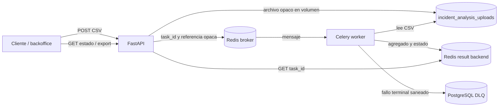
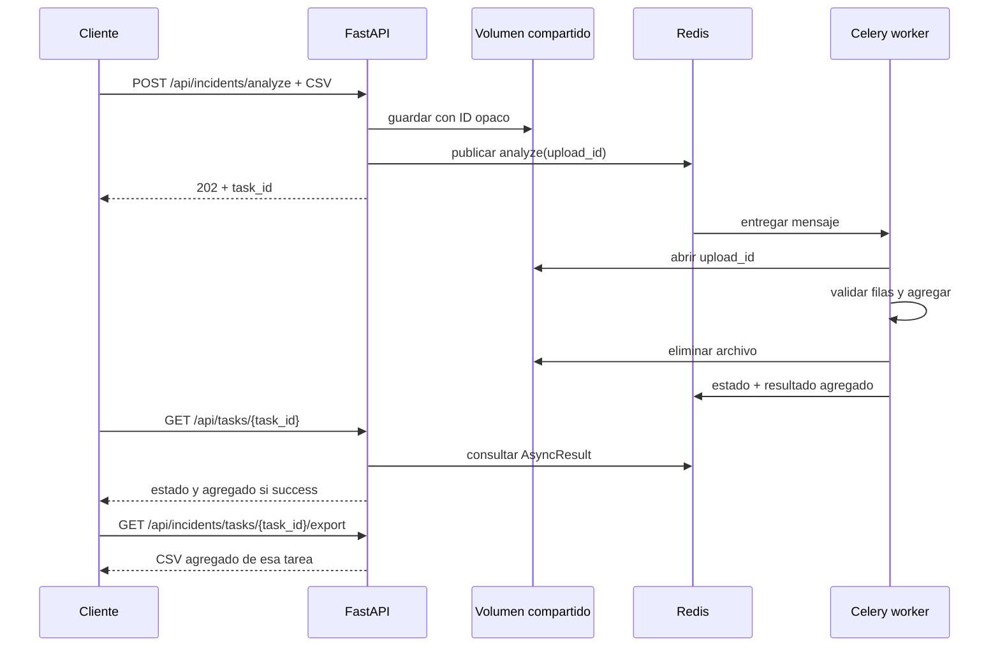

# Aprendiendo: colas, mensajeros y tareas asíncronas en Nexova

## 1. Introducción: responder no es terminar

Cuando un cliente carga un CSV de incidencias, leer y agregar todas sus filas puede tardar más que una operación HTTP sencilla. Mantener abierta la conexión durante todo el cálculo ata recursos del servidor y vuelve frágil la experiencia ante timeouts o desconexiones.

Nexova separa la **aceptación de la solicitud** de la **ejecución del análisis**. La API valida y guarda temporalmente el archivo, envía una tarea a Celery y devuelve un identificador. Un proceso worker toma después esa tarea, calcula los agregados y guarda el resultado para consultarlo.

Esto no significa que el trabajo siempre se ejecute inmediatamente ni que una respuesta HTTP 202 garantice que terminó correctamente. Significa que la petición fue aceptada para procesamiento asíncrono; su estado final debe consultarse aparte.

## 2. Las piezas y sus responsabilidades



| Pieza | Qué hace | Qué no hace |
|---|---|---|
| **FastAPI** | Valida la solicitud, guarda el upload y publica una tarea; expone consulta y exportación por tarea. | No espera a terminar todo el análisis antes de responder 202. |
| **Redis** | Lleva mensajes del broker al worker y conserva estado/resultado de Celery como backend. | No es el CSV, ni la tabla de auditoría durable de la DLQ. |
| **Celery** | Define el contrato de tarea, el envío, la ejecución, los estados y los reintentos. | No analiza el negocio por sí solo; invoca la lógica existente de incidentes. |
| **Worker** | Proceso independiente que consume la cola y corre la tarea. | No es el worker de outbox de inventario. |
| **Volumen compartido** | Permite a API y worker abrir el mismo CSV temporal. | No se comparte automáticamente entre máquinas distintas. |
| **DLQ PostgreSQL** | Conserva metadatos mínimos de fallos terminales. | No almacena filas CSV, mensajes de excepción o el resultado de Celery. |
| **Flower** | Interfaz opcional de monitoreo de Celery. | Una página healthy no demuestra por sí sola el estado terminal de una tarea particular. |

El nombre configurado de la app es `app.celery_app:celery_app`; el nombre de la tarea de análisis es `nexova.incidents.analyze`.

## 3. Cola, mensaje, tarea, resultado: conceptos que no hay que mezclar

- **Cola:** canal lógico donde esperan mensajes que un consumidor puede ejecutar. No es un archivo ni una lista de resultados de negocio.
- **Mensaje:** instrucción serializable que viaja por el broker. En este flujo incluye una referencia opaca al upload, no filas del CSV.
- **Tarea:** unidad de trabajo definida en Python/Celery. Aquí llama al lector y al agregador de incidentes existentes.
- **Task ID:** identificador opaco de una ejecución concreta. El cliente lo usa para preguntar por esa ejecución, no para inferir que ya acabó.
- **Estado:** etapa observada por Celery: puede ser `pending`, `started`, `retry`, `success`, `failure` o `revoked`.
- **Resultado:** al tener éxito, el agregado asociado a esa tarea; no es un “último resultado” global que podría cruzar solicitudes concurrentes.
- **DLQ (dead-letter queue):** en este proyecto, tabla persistente para registrar fallos terminales. No es la cola Redis de mensajes pendientes.

Un `pending` es ambiguo: puede representar una tarea esperando, un ID sin estado persistido o uno desconocido. No se debe presentar como confirmación independiente de que un worker ya la recibió.

## 4. Recorrido de una solicitud

1. El cliente envía `POST /api/incidents/analyze` como `multipart/form-data`, con el campo `file`.
2. FastAPI revisa presencia, extensión/formato, tamaño y estructura CSV requerida para aceptar la petición.
3. La API crea un nombre interno opaco para el CSV y lo escribe bajo `INCIDENT_ANALYSIS_UPLOAD_DIR`, con acceso limitado.
4. La API publica la tarea Celery. El mensaje incluye la referencia interna, no el contenido.
5. La API devuelve HTTP **202 Accepted** y un `task_id`.
6. Redis entrega el mensaje a un worker disponible. El worker recupera el archivo desde el volumen compartido y ejecuta el análisis.
7. Celery guarda el estado y, si tuvo éxito, el resultado agregado en el backend Redis.
8. El cliente consulta `GET /api/tasks/{task_id}` hasta ver un estado terminal.
9. Si fue exitoso, puede obtener el CSV agregado de esa misma ejecución mediante `GET /api/incidents/tasks/{task_id}/export`.
10. El upload temporal se elimina al completar con éxito o al agotar los reintentos y fallar terminalmente. La limpieza de temporales antiguos cubre abandonos.



Los errores de entrada se rechazan antes de encolar: 400 para ausencia/formato/contenido inválido y 413 para un archivo que supera el límite configurado. El límite predeterminado es 10 MiB y Compose configura `INCIDENT_ANALYSIS_MAX_UPLOAD_BYTES=10485760`.

## 5. Reintentos y backoff

Un retry no es una repetición ciega de todo error. La tarea clasifica ciertos fallos transitorios, como timeouts y algunos errores de E/S o conexión; errores de datos/permisos no deben repetirse automáticamente.

La política implementada permite **dos reintentos**: hasta **tres intentos totales**. Entre intentos se usan esperas exponenciales de 1 y 2 segundos. El CSV se conserva mientras pueda haber un retry; tras éxito o fallo terminal se elimina. Un worker caído o un broker temporalmente indisponible son problemas operacionales distintos del retry que la tarea aplica a excepciones seleccionadas durante el análisis.

Repetir el análisis es seguro porque es determinista y produce un agregado asociado a un task ID. En una tarea terminal, la persistencia de DLQ se realiza de forma idempotente por `task_id`.

## 6. Privacidad, archivos y DLQ

El CSV puede contener emails, descripciones e identificadores. Por ello:

- Ni filas ni campos personales se serializan dentro del mensaje Celery, se registran en logs o se guardan como resultado de tarea.
- El resultado solo contiene métricas/agregados permitidos.
- El ID del archivo se genera en servidor; no se acepta una ruta arbitraria aportada por el cliente.
- El volumen debe ser accesible únicamente para los servicios necesarios y su montaje debe verificarse.
- Una limpieza oportunista retira archivos abandonados después de la retención configurada (24 horas en Compose).
- La tabla `public.celery_incident_analysis_dlq` guarda identificador/nombre de tarea, fecha, intento y tipo de error saneado; no guarda mensajes de excepción, CSV ni PII.
- La DLQ usa `CELERY_DATABASE_URL` con TLS requerido. **Limitación importante:** la URL efectiva comparte base PostgreSQL y esquema `public` con `TELEMETRY_DATABASE_URL`; hoy el aislamiento es por tabla, no por base, esquema o rol.

El volumen Compose es compartido por los contenedores API y worker en un solo host. Al distribuir workers en varias máquinas, hay que sustituirlo por almacenamiento de objetos compartido con permisos y retención apropiados; montar un directorio local independiente no bastará.

## 7. Ejecutar en local y con Docker

### Compose

Desde la raíz del repositorio, con el `.env` de entorno configurado:

```powershell
docker compose up -d redis backend incident-analysis-worker flower
docker compose ps redis backend incident-analysis-worker flower
docker compose logs -f incident-analysis-worker
```

El broker dentro de la red Compose es `redis://redis:6379/0`. Para parar solo esta parte del stack:

```powershell
docker compose stop flower incident-analysis-worker backend redis
```

### Local en Windows

Inicia Redis en el host y usa `redis://localhost:6379/0`. API y worker deben compartir un mismo directorio de archivos. Desde la raíz en PowerShell:

```powershell
$env:REDIS_URL = "redis://localhost:6379/0"
$env:INCIDENT_ANALYSIS_UPLOAD_DIR = Join-Path $env:TEMP "nexova-incident-analysis"
New-Item -ItemType Directory -Force $env:INCIDENT_ANALYSIS_UPLOAD_DIR | Out-Null
Set-Location services/api
uv sync --extra test
uv run uvicorn app.main:app --host 127.0.0.1 --port 8000
```

En una terminal aparte, con iguales variables de Redis y del directorio:

```powershell
Set-Location services/api
uv run celery -A app.celery_app:celery_app worker --loglevel=INFO --pool=solo
```

Flower es opcional. En otra terminal:

```powershell
Set-Location services/api
uv run celery -A app.celery_app:celery_app flower --address=127.0.0.1 --port=5555
```

El host Redis cambia por topología: `redis` resuelve dentro de Compose; `localhost` resuelve desde Windows. No intercambiar esas URLs. Mantén también iguales `INCIDENT_ANALYSIS_UPLOAD_DIR` para la API y el worker.

## 8. Comprobar estado y resolver problemas

El cliente conserva el `task_id` devuelto por el POST y consulta, por ejemplo:

```powershell
Invoke-RestMethod http://127.0.0.1:8000/api/tasks/<task_id>
```

El endpoint se puede consultar mientras la API está activa; la exportación requiere que la tarea haya terminado en `success`:

```powershell
Invoke-WebRequest -OutFile .\incident-analysis.csv `
  http://127.0.0.1:8000/api/incidents/tasks/<task_id>/export
```

Lista de comprobación ante problemas:

1. **POST no devuelve 202:** verifica que Redis sea accesible desde la API y revisa el error de enqueue; no se debe afirmar que el trabajo fue aceptado si no se pudo publicar.
2. **Permanece `pending`:** confirma que el servicio del worker esté arriba, que escuche la cola correcta y que Redis sea el mismo broker para ambos.
3. **`failure`:** revisa logs del worker, el tipo de excepción saneado y la fila de DLQ si la escritura persistente está configurada; no esperes hallar el mensaje original ni datos del CSV en esa tabla.
4. **No encuentra el archivo:** comprueba que API y worker montan el mismo volumen/ruta, y que la retención no haya retirado un temporal huérfano.
5. **No funciona el export:** confirma el `task_id` y estado `success`; la descarga es por tarea, no por último resultado global.
6. **Flower responde pero la tarea no aparece:** health de Flower solo valida su web. Contrasta con API/Redis/logs del worker y no atribuyas a Flower una confirmación que no se haya comprobado.

El shutdown normal consiste en detener primero Flower/worker/API según el entorno y Redis después; durante el desarrollo, Ctrl+C detiene cada proceso local. No uses `docker compose down` si la intención es parar únicamente Celery: `down` puede detener otros servicios del proyecto Compose.

## 9. Pruebas y cobertura

Desde `services/api`, con el entorno `uv` configurado:

```powershell
uv run pytest -q tests/test_incident_analysis_task_reliability.py tests/test_async_incident_analysis_api.py
uv run pytest -q tests/test_local_celery_incident_analysis_integration.py
uv run pytest -q
```

La primera suite cubre política de reintentos/backoff, clasificación de errores, eliminación del CSV, sanitización e idempotencia de DLQ/TLS por mocks. La integración local encola y procesa con un worker real en proceso y Redis; el escenario que escribe DLQ necesita `CELERY_DATABASE_URL`, por lo que debe usarse una base de pruebas aislada y nunca una conexión de producción. También hay tests de API que pueden ejecutarse sin un broker real usando mocks.

El cierre Stage 4 amplió la regresión a autenticación, incidentes, inventario/outbox, suppliers y telemetría, además del backend y backoffice completos. El resultado y los fallos/caveats concretos se registran en `services/api/CELERY_ASYNC_AUDIT.md`; consulta esa evidencia antes de asumir que cada ejecución histórica cubre todos los servicios.

El worker de inventario es otro patrón: `inventory-outbox-worker` consume eventos transaccionales desde una outbox SQL y los entrega a telemetría. No lo administra Celery/Redis ni sustituye al worker `incident-analysis-worker`.

## 10. Limitaciones y aprendizaje de la validación

La validación operativa de un flujo asíncrono debe probar el recorrido completo: API acepta, broker recibe, worker ejecuta, estado llega a terminal, el resultado es consultable, el temporal se elimina y un fallo agotado queda en DLQ. Un test unitario de `retry()` no sustituye una prueba integrada; una app de Flower healthy tampoco confirma que una tarea específica se procesó.

En una prueba controlada de Compose se observó un fallo sintético terminal. El segundo caso confirmó tres intentos, estado API `failure`, registro DLQ con `attempt_count=3` y clase `FileNotFoundError`, y eliminación del CSV artificial. El primer caso falló tras un intento y su causa no se determinó: no debe presentarse como prueba de que la política de retry siempre funcionó, ni se modificó código para ocultarlo.

La construcción del backoffice compiló páginas/rutas y después Next.js finalizó con `SecurityFatalError` asociado a la versión instalada del framework. Eso bloquea concluir que el build completo pasó; no se ejecutó un upgrade automático. La suite frontend y `tsc --noEmit` sí tuvieron resultados independientes satisfactorios, tal como se detalla en la auditoría Stage 4.

## 11. Glosario

| Término | Significado práctico |
|---|---|
| **Asíncrono** | La petición solicita trabajo y recibe una respuesta antes de que ese trabajo termine. |
| **Broker** | Servicio de mensajería que guarda/entrega mensajes al consumidor; Redis en esta implementación. |
| **Worker** | Proceso consumidor que ejecuta las tareas fuera del proceso HTTP. |
| **Backoff exponencial** | Espera creciente entre reintentos; aquí 1 s y 2 s para los dos retries permitidos. |
| **Terminal** | Estado final de éxito o fallo; no se planean más retries. |
| **Backend de resultados** | Almacén consultado por Celery para estado y resultado de tarea; Redis en Nexova. |
| **DLQ** | Registro persistente de fallos terminales, separado del resultado transitorio de Celery. |
| **PII** | Información personal identificable; por ejemplo, email o descripción asociada a una persona. |
| **Volumen compartido** | Montaje de almacenamiento accesible por más de un contenedor; no implica compartirlo entre hosts. |
| **Idempotencia** | Repetir la operación no crea duplicados en el efecto que se protege; la DLQ usa el task ID. |

## 12. Conclusión

La cola desacopla la duración del análisis del tiempo de respuesta HTTP y facilita controlar concurrencia, reintentos y supervisión. A cambio, el sistema necesita Redis, workers activos, almacenamiento compartido y una forma explícita de consultar el estado. El ID de tarea, el aislamiento por solicitud, la política de limpieza y la privacidad del mensaje son partes del contrato, no detalles opcionales. Para operar de manera segura hay que mirar el resultado real de la API y del worker, distinguir Celery del outbox de inventario, y registrar claramente qué evidencia se verificó y qué quedó limitado por ambiente.
