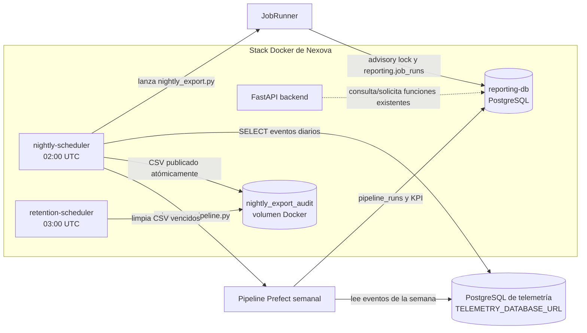

# Aprendiendo: procesos de segundo plano en Nexova

## 1. Introducción y objetivo

Esta guía explica el proceso nocturno de Nexova, el registro de sus intentos y la retención de sus CSV. El objetivo es distinguir tres cosas que suelen confundirse:

1. **El scheduler** espera una hora y lanza un programa.
2. **El job runner** coordina intentos, exclusión mutua e idempotencia en PostgreSQL.
3. **El trabajo de negocio** exporta un CSV y ejecuta el pipeline semanal existente.

La limpieza de CSV es otro proceso independiente. No borra filas de telemetría ni resultados de reporting. El código fuente es la autoridad para el comportamiento; los apartados históricos distinguen lo que puede reconstruirse de lo que no quedó registrado como fase formal.

## 2. Arquitectura general

El stack está compuesto por servicios separados. FastAPI expone la API, pero no se ocupa de mantener un bucle de espera hasta la madrugada. Los schedulers son procesos persistentes en contenedores propios. PostgreSQL conserva tanto el historial del job nocturno como el historial y resultados del pipeline de negocio. Los archivos CSV, en cambio, viven en un volumen Docker compartido.



`TELEMETRY_DATABASE_URL` y `REPORTING_DATABASE_URL` tienen responsabilidades separadas: leer la fuente de telemetría frente a conectar con el almacén de reporting. El proceso nocturno obtiene ambas configuraciones de su entorno; en Compose, `nightly-scheduler` recibe `.env`. No se debe copiar una URL real a esta guía ni a comandos compartidos. `retention-scheduler` no necesita conexión a PostgreSQL: trabaja sobre el volumen de CSV.

El pipeline de negocio tiene sus propios subflows/tareas Prefect. En el job nocturno, `nightly_export.py` lo ejecuta como **subprocess** mediante el intérprete Python actual. El script de scheduler no sustituye ni reimplementa el ETL.

## 3. Fases del trabajo y archivos principales

No se encontró una bitácora que asigne nombres oficiales a cada Fase 0–4 de este trabajo. La tabla siguiente es una reconstrucción didáctica a partir del código, las pruebas y los commits existentes —no afirma que esos nombres fueran hitos aprobados en su momento—:

| Fase | Qué se puede afirmar | Archivos/resultado |
|---|---|---|
| **0 — Base y contrato** | Se parte de un pipeline semanal de reporting ya existente. El job diario añade un CSV de auditoría separado: el pipeline de negocio sigue leyendo directamente telemetría. | `data/pipelines/pipeline.py`; `data/pipelines/PIPELINE_DESIGN.md`; documentación en `docs/aprendiendo/aprendiendo-pipeline-negocio.md`. |
| **1 — Ejecución rastreable** | Se incorporó `JobRunner`, el advisory lock PostgreSQL por nombre de job y los registros/estados de `reporting.job_runs`. | `services/job_runner.py`; `data/pipelines/migrations/002_job_runs.sql`; `services/tests/test_job_runner.py`. |
| **2 — Export y orquestación nocturna** | Se añadieron la selección de fecha UTC, exportación diaria CSV y llamada del pipeline semanal como proceso hijo. El commit `00889de` documenta la incorporación del job runner y export. | `scripts/nightly_export.py`; `services/nightly_scheduler.py`; `services/scheduler.Dockerfile`; pruebas en `services/tests/test_nightly_export.py`. |
| **3 — Retención segura** | Se aisló el scheduler de retención y se coordinó publisher/cleaner con locks compartidos sobre un volumen. El commit `5fb3833` contiene export y retención; `668cc52` registra la inclusión del scheduler dedicado de retención. | `scripts/retention_manager.py`; `scripts/csv_artifact_lock.py`; `services/retention_scheduler.py`; `services/retention-scheduler.Dockerfile`; `docker-compose.yml`. |
| **4 — Validación y operación** | Se validaron pruebas unitarias, PostgreSQL desechable y lock entre contenedores; se documentaron operaciones en `services/PHASE3_OPERATIONS.md`. La evidencia detallada está en la sección 8. | `services/tests/`; migraciones `001_reporting.sql` y `002_job_runs.sql`; Compose. Esta fase de documentación resume esa evidencia, no vuelve a ejecutar pruebas. |

Las migraciones SQL describen los esquemas requeridos. En el trabajo de validación se aplicaron contra PostgreSQL desechable y también se comprobó el esquema. **No se afirma que se hayan aplicado a Supabase ni a otra base persistente** como parte de esta documentación.

## 4. Qué sucede en el proceso nocturno

El contenedor `nightly-scheduler` ejecuta `services/nightly_scheduler.py`. Este calcula el siguiente límite de las **02:00 UTC**, espera usando un contador monotónico y lanza `scripts/nightly_export.py`. SIGTERM/SIGINT solicitan un cierre ordenado. El scheduler intenta de nuevo al siguiente día si la ejecución acaba con error; no implementa por sí mismo reintentos inmediatos.

El programa determina la fecha objetivo con esta precedencia:

1. `--target-date YYYY-MM-DD` (si se llama manualmente).
2. Variable `TARGET_DATE` (si no se dio argumento).
3. Ayer según UTC (valor por defecto, independiente de la zona horaria del host).

La fecha se valida estrictamente como calendario ISO. Para el target `2026-11-11`, por ejemplo, el CSV corresponde al día UTC 11 y la semana ISO empieza el lunes `2026-11-09`.

Con la fecha ya resuelta, el proceso:

1. Pide a `JobRunner` una concesión para `nightly_export` y esa fecha.
2. Si el job está ocupado o el target ya quedó completado, registra que se omite y termina sin exportar ni lanzar el pipeline.
3. Consulta `public.telemetry_events` en el intervalo UTC `[00:00 del target, 00:00 del día siguiente)`. Exporta únicamente `inbound_order_created`, `outbound_order_created`, `stock_threshold_triggered` y `kit_cost_variance_detected`, ordenados por timestamp e ID.
4. Escribe `event_id`, `event_type`, `timestamp` y `tags` al CSV `telemetry-events-YYYY-MM-DD.csv`.
5. Calcula el lunes de la semana ISO que contiene el target y lanza `data/pipelines/pipeline.py --week-start YYYY-MM-DD --trigger-type scheduled` como subprocess.
6. Si ambos pasos terminan bien, marca el intento como completado. Si falla la exportación o el proceso hijo, registra el intento como fallido, conserva el error y libera la conexión/lock.

El pipeline recibe `week_start` y vuelve a leer la ventana semanal completa `[lunes 00:00 UTC, lunes siguiente 00:00 UTC)`. Por tanto, el job nocturno es diario, pero el trabajo de negocio es semanal y recalcula la semana ISO del target. No confundir el CSV diario con la salida agregada semanal.

```mermaid
sequenceDiagram
    participant S as nightly-scheduler
    participant J as JobRunner
    participant R as PostgreSQL reporting
    participant T as PostgreSQL telemetría
    participant V as volumen CSV
    participant P as pipeline semanal
    S->>J: acquire(nightly_export, target_date)
    J->>R: pg_try_advisory_lock + leer/crear intento
    alt lock ocupado o target completado
        J-->>S: sin concesión; omitir
    else concesión obtenida
        S->>T: SELECT eventos del día UTC
        T-->>S: filas permitidas
        S->>V: temporal, lock, os.replace
        S->>P: subprocess --week-start lunes --trigger-type scheduled
        P->>T: extraer semana ISO
        P->>R: pipeline_runs + upsert KPI
        S->>J: complete() o fail(error)
        J->>R: estado terminal; cerrar sesión y liberar lock
    end
```

## 5. Registro, locks e idempotencia

### `reporting.job_runs`: historial del scheduler

`services/job_runner.py` utiliza `REPORTING_DATABASE_URL`. Cada intento de un par `(job_name, target_date)` recibe UUID y número de intento. Los estados son `pending`, `processing`, `completed` y `failed`; el código crea el intento y lo pasa a `processing`, y luego lo finaliza.

Antes de crear un intento, el runner obtiene un **advisory lock de sesión** con clave basada en `nightly-job:<job_name>`. Es global para ese nombre de job, no por fecha: impide que dos ejecuciones nocturnas trabajen a la vez aunque pidan targets distintos. La sesión PostgreSQL propietaria conserva el lock durante la exportación y el subprocess. PostgreSQL lo libera al cerrar la sesión, incluso si el proceso muere abruptamente.

La idempotencia tiene una condición precisa: si ya existe un intento completado para `(job_name, target_date)`, el runner no inicia el trabajo de nuevo. Los intentos fallidos se conservan y un retry crea un número de intento nuevo. Si el siguiente proceso obtiene el lock y encuentra filas `pending`/`processing` abandonadas para ese job, las marca `failed` antes de crear otro intento. Esto es recuperación del historial; no revierte efectos externos que ya se hayan producido antes de la interrupción.

### `reporting.pipeline_runs`: historial de negocio distinto

El pipeline mantiene su propio historial en `reporting.pipeline_runs`, con `pipeline_name`, `week_start`, estado (`running`, `completed` o `failed`), contadores y tipo de trigger. Las KPI se guardan en `reporting.weekly_office_program_performance`, con clave única oficina/programa/semana y upsert transaccional.

Así, `job_runs` responde «¿qué pasó con el intento diario del scheduler?»; `pipeline_runs` responde «¿qué pasó con el cálculo semanal de negocio?». Tener un job completado no es lo mismo que un registro del pipeline, y el CSV no es una tabla de auditoría permanente.

## 6. Retención de CSV y coordinación de archivos

El scheduler separado ejecuta `services/retention_scheduler.py` a las **03:00 UTC** por defecto. `RETENTION_SCHEDULE_UTC=HH:MM` permite cambiar la hora en formato estricto. Al llegar a la hora, el scheduler lanza `scripts/retention_manager.py`.

La política usa fecha calendario UTC y mantiene archivos con edad **0 a 30 días inclusive**. Elimina solamente los mayores de 30 días que coincidan exactamente con `telemetry-events-YYYY-MM-DD.csv` y contengan una fecha real ISO. Por ejemplo, edad 30 se conserva; edad 31 es candidata a borrado. No toca `.tmp`, nombres ajenos, fechas inválidas, subdirectorios, datos de telemetría ni tablas `reporting.*`.

Publisher y cleaner comparten locks de sistema operativo en `.locks/` dentro del mismo volumen:

- El exportador obtiene el lock por archivo mientras escribe un `.tmp` y publica con `os.replace`, operación atómica en el mismo volumen.
- El cleaner obtiene primero un lock global no bloqueante para excluir otros cleaners y, para cada CSV candidato, el mismo lock individual no bloqueante que usa el publisher.
- Si el publisher está trabajando, el cleaner registra `skipped_in_use` y deja el archivo intacto. Los locks del SO se liberan al terminar o morir el proceso; los archivos de lock permanecen deliberadamente para evitar carreras de inode.
- La implementación usa `fcntl.flock` en POSIX y `msvcrt.locking` en Windows.

Los logs de la retención son líneas JSON con resultado, fecha del CSV, fecha de borrado, error y conteo cuando aplica. No hay un archivo de auditoría remoto ni una tabla de auditoría SQL para estas eliminaciones.

## 7. Schedulers y Docker

`docker-compose.yml` define `nightly-scheduler` y `retention-scheduler` como servicios independientes del backend FastAPI, ambos con `restart: unless-stopped` y zona UTC. El scheduler nocturno espera a que `reporting-db` esté healthy. Cada servicio usa su Dockerfile: `services/scheduler.Dockerfile` instala dependencias del export y copia el pipeline; `services/retention-scheduler.Dockerfile` contiene solo scheduler/manager/lock y no requiere psycopg ni Prefect.

Ambos contenedores montan el volumen nombrado `nightly_export_audit` en `/var/lib/nightly-export`; el directorio operativo configurado es `/var/lib/nightly-export/audit`. El volumen permite conservar los CSV fuera del ciclo de vida del contenedor y compartirlos con el cleaner. El volumen de base `reporting_postgres_data` es distinto.

Los schedulers escriben a stdout/stderr. Compose usa el driver `json-file` con `max-size: 10m` y `max-file: 10`: limita aproximadamente el tamaño de logs conservados, **no garantiza un período fijo de días**. Rotación de logs Docker y retención de CSV son políticas diferentes.

## 8. Pruebas y evidencia disponible

La implementación tiene pruebas en `services/tests/`:

- **Unitarias:** selección y validación de fecha, límite UTC, semana ISO, orden y comando del subprocess, errores, estados e idempotencia del job runner, y fronteras de retención.
- **PostgreSQL desechable:** pruebas de sesiones independientes y advisory locks reales, exclusión de procesos concurrentes, terminación abrupta y recuperación de intentos, retry y target ya completado. El fixture aplica las migraciones sobre la base configurada solo después de protegerse frente a Supabase, la base persistente de Compose y nombres de DB no claramente de test.
- **Volumen Docker de prueba:** dos imágenes distintas —nightly y retention— comparten un volumen temporal con nombre único. Se comprueba que el cleaner no elimina un CSV bajo lock y que el lock se libera tras salida normal o abrupta. La prueba no monta el volumen operativo.
- **Pipeline semanal:** los tests del Hito 6 validan transformaciones/flow del pipeline. No son sustituto de pruebas del scheduler nocturno.

Evidencia reportada en la validación previa a esta guía: suite conjunta de procesos **71 passed, 9 skipped** en la pasada sin URL de integración; **8/8** pruebas PostgreSQL pasaron por separado contra PostgreSQL desechable, y la prueba de lock Docker pasó **1/1** usando imágenes ya construidas. Los tests focalizados del pipeline Hito 6: **21 passed**. Son resultados históricos, no se volvieron a ejecutar al redactar esta guía. El cierre de Prefect temporal produjo ruido de logging al cerrar el servidor, pero no cambió el resultado exitoso de esos tests.

Los tests demuestran propiedades controladas, no garantizan que las credenciales operativas estén configuradas correctamente, que el cron haya completado una ejecución natural ni que Supabase tenga las migraciones. Tampoco prueban una política de recuperación de efectos externos parcialmente completados: por ejemplo, si el subprocess alcanza a cargar resultados y el proceso padre muere antes de completar `job_runs`, el reintento del target puede volver a invocar el pipeline; su upsert semanal está diseñado para recalcular/reemplazar, no sumar duplicados.

## 9. Problemas encontrados y soluciones

- **Mezclar historial del job con el del pipeline:** se mantuvieron `job_runs` y `pipeline_runs` como historiales distintos porque operan a niveles y fechas diferentes.
- **Fecha del host o límite ambiguo:** todas las fechas y horarios operativos se normalizan a UTC; el día se consulta con límite superior exclusivo.
- **Publicación CSV a medio escribir o carrera con retención:** lock individual compartido, escritura temporal y reemplazo atómico.
- **Lock obsoleto tras fallo:** lock gestionado por el SO y persistencia separada de filas de intentos abandonadas, recuperadas al adquirir el siguiente lock.
- **Aislamiento de pruebas:** PostgreSQL de integración en puerto local `55432` con almacenamiento `tmpfs`; URL explícita con nombre de base de test; volumen/containers Docker de lock temporales. No se debe sustituir esa URL por Supabase ni por la base normal de Compose.
- **Recuperación accidental de Compose:** durante operaciones previas se ejecutó `docker compose --profile integration down`; Compose retiró también servicios y red del proyecto, aunque no eliminó los volúmenes nombrados. Tras autorización de recuperación, `docker compose up --build -d` reconstruyó la red y los ocho servicios, conservando los volúmenes existentes. Se verificaron los servicios y respuestas HTTP 200 en backend, website, backoffice y Prefect. El worker de reporting mostró un aviso transitorio de API no disponible al arrancar y luego inició correctamente. Aprendizaje operativo: `--profile integration down` no limita el efecto de `down` al contenedor de integración; afecta al proyecto Compose completo. Evitar `down` como limpieza de una prueba cuando no se quiera detener el stack y no usar comandos de prune.

La incidencia anterior no forma parte del comportamiento normal de los schedulers; se documenta para que la recuperación y el alcance de Compose queden claros.

## 10. Operación segura

Los siguientes comandos se documentan como referencia; **no se ejecutaron para redactar esta guía**. Antes de usarlos, confirmar el directorio de trabajo, el Compose correcto, variables de entorno y destino. No introducir secretos en la línea de comandos.

### Consultar servicios y logs

```powershell
docker compose ps
docker compose logs -f nightly-scheduler
docker compose logs -f retention-scheduler
```

En los logs nocturnos, comprobar el próximo horario, `target_date`, estados `starting`, `audit_exported`, `pipeline_started`, `completed`/`failed` y resultado del subprocess. Para retención, comprobar la hora configurada, los resultados JSON y el conteo de eliminaciones.

### Arranque y ejecución manual

Para iniciar o actualizar el stack desde su raíz, la referencia usual es `docker compose up -d --build`. No se necesita reiniciar FastAPI para que los schedulers existan: son servicios Compose separados.

Una ejecución manual de export para una fecha explícita se puede solicitar desde el contenedor nocturno:

```powershell
docker compose exec nightly-scheduler python /app/scripts/nightly_export.py --target-date 2026-11-11
```

Esto conecta con la base definida por el entorno y puede escribir CSV y resultados de negocio. No ejecutar sin confirmar que URLs, fecha y destino son los deseados. El job runner saltará un target ya completado o una ejecución concurrente.

Para invocar el cleaner directamente, la interfaz CLI inspeccionada es `--directory`:

```powershell
docker compose exec retention-scheduler python /app/scripts/retention_manager.py --directory /var/lib/nightly-export/audit
```

Este comando **puede borrar** CSV elegibles dentro de ese directorio. Confirmar primero el montaje y el path efectivo; no apuntar a rutas amplias como `/`, a una carpeta compartida con otros datos o a un volumen diferente del esperado. El matcher es estricto, pero no sustituye esa comprobación.

### Migraciones y mantenimiento

Las migraciones necesarias para reporting/job history son `data/pipelines/migrations/001_reporting.sql` y `002_job_runs.sql`. Antes de aplicarlas a una base persistente hay que confirmar entorno, backup, permisos, URL y plan aprobado. La validación referida en esta guía usó bases desechables; aquí no se ejecuta ninguna migración. No apuntar pruebas a Supabase ni eliminar volúmenes para resolver un problema de contenedores.

## 11. Glosario

| Término | Significado en este proyecto |
|---|---|
| **Proceso de segundo plano** | Proceso que opera independientemente de una petición HTTP, como el scheduler nocturno o el de retención. |
| **Scheduler** | Bucle persistente que calcula cuándo debe lanzarse una tarea y crea el proceso hijo. |
| **Subprocess** | Programa independiente iniciado por otro proceso; aquí el export inicia el CLI del pipeline semanal. |
| **Advisory lock** | Lock cooperativo de PostgreSQL identificado por una clave; la sesión propietaria lo mantiene hasta liberarlo/cerrarse. |
| **Idempotencia** | Repetir una operación no duplica el efecto definido. En el job, un target completado se omite; en el pipeline, el upsert reemplaza la fila semanal. |
| **Atomic write** | Publicar el CSV completo mediante reemplazo atómico (`os.replace`) en vez de exponer el archivo mientras se escribe. |
| **UTC** | Zona horaria de referencia para fechas, cortes de día y horarios de scheduler, evitando dependencia de la zona local. |
| **Retention policy** | Regla local de cuánto tiempo conservar un archivo; aquí se conservan los CSV de edad 0–30 días inclusivos. |
| **Retry** | Nuevo intento de un trabajo fallido. Los errores/intentos previos permanecen en el historial; no equivale a borrar el error previo. |
| **Docker volume** | Almacenamiento nombrado gestionado por Docker, independiente del contenedor; aquí persiste y comparte los CSV entre schedulers. |

## 12. Conclusiones y pendientes antes de producción

La solución separa horarios, estado de job, ETL de negocio y archivos de auditoría. Esto evita acoplar el ciclo de vida del cron a FastAPI, permite distinguir intentos fallidos de un pipeline fallido y coordina lectura/escritura/retención del CSV entre contenedores. Las protecciones de concurrencia e idempotencia reducen duplicados, pero no convierten la ejecución en una transacción distribuida entre PostgreSQL, filesystem y proceso hijo.

Antes de depender de este mecanismo en producción se recomienda confirmar y documentar: aplicación aprobada de ambas migraciones en cada entorno persistente; permisos mínimos y rotación segura de credenciales; alertas ante fallo o ausencia de ejecución; monitorización de espacio y backup/retención acorde a la política de datos; y un runbook de reintento que contemple efectos ya realizados por el subprocess. Los límites de retención CSV y rotación de logs deben aprobarse como políticas separadas. También conviene observar ejecuciones naturales y confirmar resultados con datos válidos, sin tomar el estado `running` del servicio como prueba de que un job terminó correctamente.

Esta guía no ejecutó servicios, schedulers, pruebas, comandos Docker, consultas de bases ni migraciones. Documenta la implementación y la evidencia previa de manera verificable.
