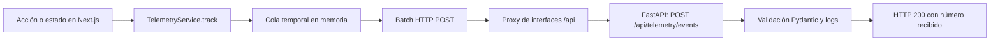

# Aprendiendo: telemetría frontend en Nexova

Guía didáctica de la implementación de telemetría del backoffice de Nexova. Explica el recorrido de un evento desde que ocurre en la interfaz hasta que el backend lo recibe. Distingue el código activo de los contratos de diseño y de las mejoras que aún no existen.

## Estado de la Fase 4

- El frontend crea eventos con envelope CloudEvents 1.0 y los agrupa en lotes en memoria.
- El backend recibe `POST /api/telemetry/events`, valida el envelope con Pydantic y registra el número y los tipos de eventos.
- El endpoint **no persiste** los eventos: no hay almacenamiento de telemetría en PostgreSQL, TinyDB ni una cola durable.
- La suite backend terminó con **445 tests correctos, 0 fallos y 1 omitido**. La suite frontend terminó con **87 tests correctos**. TypeScript no presentó errores y el build de Next.js generó 18 rutas.
- En la integración con Docker Compose se comprobó el endpoint con respuestas HTTP 200, el preflight CORS y un lote de cuatro eventos de tipos distintos en una petición.
- La observación del lote no demuestra por sí sola el temporizador de diez segundos, el umbral de veinte eventos, los reintentos o `sendBeacon` en un navegador real.

---

## 1. ¿Qué es la telemetría?

La **telemetría** consiste en registrar hechos sobre el uso y el estado de una aplicación para entender qué ocurre fuera del código fuente. Un evento puede representar, por ejemplo, que una persona inició sesión, creó una entrada de inventario o encontró un error de renderizado.

No es lo mismo que guardar toda la actividad de una persona. Una buena instrumentación selecciona hechos útiles, limita los datos que envía y define una finalidad para cada evento. En Nexova se busca que la información sirva para cinco objetivos:

1. **Personalización:** adaptar recorridos o sugerencias según el uso. Para hacerlo con seguridad se necesitaría una identidad seudónima disponible y una política clara de uso. La implementación actual no genera un `user_uuid` para completar eventos.
2. **Análisis del producto:** entender qué pantallas y flujos se utilizan y dónde se producen errores o abandonos. Los eventos frontend dan señales, pero todavía no hay persistencia ni panel analítico.
3. **Observabilidad:** detectar problemas técnicos, como un error de renderizado o fallos de envío. El evento `frontend_render_error` está instrumentado; los logs HTTP del backend siguen siendo independientes de la telemetría.
4. **Experimentación:** comparar recorridos o resultados de cambios de producto. Esto requiere definir experimentos, segmentos y criterios; no hay una plataforma de experimentación implementada.
5. **Soporte:** aportar contexto para investigar una incidencia comunicada por una persona usuaria. Los eventos actuales no sustituyen los logs, y deben evitarse credenciales, tokens y datos personales innecesarios.

Estos cinco objetivos explican para qué podría servir el sistema; no significan que ya existan dashboards, personalización automatizada o experimentos activos.

## 2. Arquitectura y recorrido de un evento

El recorrido actual es:



En el navegador, los componentes no hablan directamente con la base de datos. Llaman a `TelemetryService.track()`. El servicio construye un evento y lo deja en una cola local; más tarde envía un JSON con la propiedad `events`. En Docker Compose, el endpoint es relativo (`/api/telemetry/events`): el proxy de `uis/proxy-server.js` reenvía `/api/*` desde el puerto del backoffice al servicio `backend:8000`.

El backend valida el cuerpo y registra el lote. Después responde, por ejemplo, `{"received":4}`. Ese número confirma que la petición se aceptó; no confirma que los eventos se hayan almacenado.

## 3. Formato de los eventos: CloudEvents 1.0

CloudEvents define un envelope común para describir eventos aunque procedan de partes distintas de una aplicación. Así, transporte y datos de negocio quedan separados: el envelope dice qué pasó y dónde/cuándo; `data` contiene los detalles específicos.

Ejemplo representativo del formato generado por el frontend:

```json
{
  "specversion": "1.0",
  "source": "/nexova/auth",
  "id": "550e8400-e29b-41d4-a716-446655440000",
  "type": "login_succeeded",
  "time": "2026-11-03T10:00:00.000Z",
  "datacontenttype": "application/json",
  "data": {},
  "sessionId": "8c82a7d8-6baa-4dc8-a58b-d74e4fd5022d",
  "schemaVersion": "1.0.0"
}
```

- `specversion` identifica la versión del envelope CloudEvents.
- `source` identifica el área emisora, por ejemplo `/nexova/auth` o `/nexova/inventory`.
- `id` es un UUID generado para ese evento. Puede ayudar a deduplicar en el futuro, pero el backend actual no hace deduplicación.
- `type` nombra el hecho, por ejemplo `login_succeeded`.
- `time` representa cuándo ocurrió el hecho, no cuándo se recibió.
- `datacontenttype` describe el formato de `data`.
- `data` contiene las propiedades propias del evento.
- `sessionId` y `schemaVersion` son extensiones usadas por el cliente. `traceparent` está definido como opcional en los tipos, pero el cliente no lo genera actualmente.

El servicio usa `crypto.randomUUID()` cuando está disponible y una alternativa local para generar identificadores. No se debe confundir un `id` de evento con `user_uuid`: tienen propósitos distintos.

### El papel de `event-schemas.json`

[`docs/telemetry/event-schemas.json`](telemetry/event-schemas.json) documenta contratos y un catálogo más amplio, incluidos eventos futuros y payloads propuestos. Es una referencia de diseño: no se importa ni se valida automáticamente en el frontend ni en el backend. Parte de sus metadatos aún afirma que no existe endpoint de telemetría; esa afirmación quedó desactualizada al implementarse la recepción de Fase 4.

En ejecución, `TelemetryService` solo comprueba que el tipo esté en su lista permitida. Pydantic valida el envelope, pero no contrasta cada `data` con los schemas por evento. Por ello, que una propiedad aparezca en `event-schemas.json` no significa que se emita ni que la API la valide.

## 4. Servicio centralizado: `TelemetryService`

El servicio se encuentra en `uis/backoffice/talent-pipeline-tracker/lib/telemetry/telemetry-service.ts` y se usa como singleton: los componentes obtienen la misma instancia en vez de crear una cola independiente cada uno.

El flujo de `track(eventType, properties)` es:

1. Comprueba que el servicio esté inicializado y no destruido.
2. Comprueba que `eventType` pertenezca a `APPROVED_FRONTEND_EVENTS`.
3. Crea el envelope con `source`, UUID, hora UTC, tipo de contenido, `data`, `sessionId` y `schemaVersion`.
4. Añade el evento a la cola.
5. Si la cola alcanza el máximo configurado, solicita un envío.

La comprobación de tipo no valida las propiedades de `data`. Si el tipo no está aprobado, el evento se descarta y se registra una advertencia. La configuración principal vive en `lib/telemetry/telemetry-constants.ts`; los contratos TypeScript están en `lib/telemetry/telemetry-types.ts`.

El `sessionId` se genera cuando se inicializa el servicio. Existe un método `updateSession()`, pero no se invoca desde el flujo activo de la aplicación; por tanto, el servicio no añade automáticamente un `user_uuid` al envelope. Cuando el código de un evento dispone de `user_uuid`, lo incluye en `data`; cuando no, lo omite. No se inventa un UUID ni se modifica el JWT para obtenerlo.

## 5. Cola temporal y transporte HTTP

La cola es un array en memoria del proceso del navegador. La configuración actual establece:

- vaciar cada **10 segundos** mientras haya eventos;
- solicitar un vaciado al alcanzar **20 eventos**;
- timeout de petición de **5 segundos**;
- hasta **3 reintentos** tras un fallo, con backoff exponencial de **1, 2 y 4 segundos**.

El primer intento envía el lote. Si falla, la implementación recorre los eventos pendientes y los reintenta individualmente; no reenvía necesariamente el lote completo como una unidad. La cola no sobrevive a recargas, cierre del navegador o pérdida del proceso.

Cuando la página pasa a estado oculto o está descargándose, el servicio intenta usar `navigator.sendBeacon()`. Esta API está pensada para enviar datos durante el cierre sin bloquear la navegación. Que `sendBeacon()` devuelva `true` significa que el navegador aceptó poner la petición en cola, **no** que el backend la haya recibido. El código elimina la cola local tras esa aceptación, por lo que la entrega sigue siendo best-effort.

Estas cifras describen la configuración del código. No se afirma que el cronómetro, el umbral, cada demora o el envío al descargar se hayan comprobado manualmente en un navegador.

## 6. Instrumentación del frontend

La lista de abajo distingue eventos emitidos por código activo de `section_viewed`, pendiente de integración. Los eventos se envían después de la operación relevante cuando esa operación tiene una confirmación del backend.

### Navegación

`LayoutTelemetryProvider`, montado desde `AuthShell`, inicializa el servicio y usa `useSectionTracking()` para registrar `frontend_page_loaded` al cargar o cambiar de ruta. El evento incluye la ruta y un tiempo de carga acotado. El hook tiene código para `section_viewed`, pero el provider establece `trackSectionView: false`; además, la función que mapea rutas a secciones no está conectada a una llamada activa.

`section_viewed` permanece pendiente: su uso previsto necesita una identidad `user_uuid` consistente, que no está disponible en todos los flujos. No se debe inferir ni fabricar esa identidad para habilitarlo.

### Autenticación y formularios

`AuthForm.tsx` emite:

- `form_validation_failed` si falla la validación local, con formulario, campo y error de validación;
- `login_succeeded` después de completar el inicio de sesión; extrae `user_uuid` del JWT solo si el claim está disponible;
- `login_failed` al capturar un error del inicio de sesión. Actualmente clasifica el motivo como `invalid_credentials`, incluso si el error capturado tuviera otra causa;
- `account_created` después del registro. No añade `user_uuid` porque la respuesta de registro no lo proporciona al frontend;
- `session_expired` cuando la pantalla de login se presenta como sesión expirada, añadiendo `user_uuid` solo si puede leerlo del JWT existente.

Los formularios de entrada y salida de inventario usan `useFormLifecycleTracking.ts` para registrar `form_opened` y `form_abandoned`, correlacionados con un `instance_id`. El abandono se detecta por inactividad o cuando la pestaña pasa a segundo plano. Un envío correcto llama a `markFormAsSubmitted()` para que no se cuente ese formulario como abandonado. Este hook no significa que todos los formularios del producto tengan instrumentación de ciclo de vida.

### Inventario, incidencias y proveedores

- `InboundFormPanel.tsx` emite `inbound_order_created` solo después de que la API confirma la entrada.
- `OutboundFormPanel.tsx` emite `outbound_order_created` solo después de que la API confirma la salida.
- `IncidentManagerPanel.tsx` emite `incident_status_changed` después de actualizar el estado de una incidencia.
- `SupplierDirectoryPanel.tsx` emite `supplier_rate_updated` después de actualizar la tarifa.

Estos eventos registran propiedades del cambio funcional. No incluyen automáticamente `user_uuid`; cada evento pasa únicamente las propiedades escritas en su llamada a `track()`.

### Errores de renderizado

`app/error.tsx` emite `frontend_render_error` desde el Error Boundary raíz cuando el error tiene `digest`. También escribe un log en consola. Este es un evento de error de interfaz; no sustituye al reporte de errores del servidor.

### Catálogo permitido frente a eventos activos

`APPROVED_FRONTEND_EVENTS` contiene 13 tipos activos en las llamadas anteriores más `section_viewed`, que está permitido por la lista pero no conectado desde el provider. Otros tipos de `event-schemas.json`, como umbrales de stock o análisis de incidencias, permanecen definidos como catálogo o propuesta; no deben presentarse como emitidos por esta instrumentación frontend.

## 7. Backend receptor y validación

El receptor está en `services/api/app/telemetry/router.py`, con prefijo `/api/telemetry`; el endpoint completo es `POST /api/telemetry/events`. Los modelos están en `services/api/app/telemetry/models.py`:

- `TelemetryEvent` representa un evento.
- `TelemetryBatch` representa el objeto raíz `{ "events": [...] }`.
- `TelemetryResponse` representa `{ "received": número }`.

Pydantic comprueba, entre otros puntos, `specversion` igual a `1.0`, un `id` con formato UUID, longitudes básicas, `datacontenttype` igual a `application/json`, `data` como objeto y una forma básica de timestamp RFC 3339. Si falta un campo obligatorio o falla el envelope, FastAPI devuelve un error de validación (normalmente HTTP 422).

El endpoint acepta lotes vacíos y responde con `received: 0`. Para lotes válidos registra el total y los tipos de eventos, y devuelve HTTP 200. Actualmente no escribe los eventos en base de datos ni los deja en una cola del backend. La ruta es un receptor provisional para validar la integración frontend-backend, no un sistema durable de observabilidad.

La validación de `data` es genérica: el backend no verifica que `login_succeeded`, por ejemplo, contenga un conjunto concreto de propiedades. Tampoco impone una lista de tipos de evento. Hay una diferencia entre el contrato ideal descrito en el JSON Schema y la validación realmente activa, que se debe cerrar antes de usar estos datos como registros analíticos fiables.

## 8. Configuración y ejecución

`NEXT_PUBLIC_TELEMETRY_ENDPOINT` configura la URL usada por el frontend. El valor previsto en Docker es `/api/telemetry/events`, una ruta del mismo origen. Al ser una variable `NEXT_PUBLIC_*`, puede formar parte del código entregado al navegador: no debe contener secretos.

La configuración se define en `uis/backoffice/talent-pipeline-tracker/lib/telemetry/telemetry-constants.ts`; `uis/Dockerfile` incluye un valor predeterminado y `docker-compose.yml` pasa la variable al servicio `interfaces`. El proxy de `uis/proxy-server.js` envía las peticiones `/api/*` al backend (`BACKEND_URL`, normalmente `http://backend:8000`) y el resto del tráfico del backoffice a Next.js en el puerto interno `3002`.

CORS es relevante cuando el navegador llama a un origen distinto. En la topología Docker normal, el navegador llama al proxy por el mismo origen del backoffice, que luego llama al backend dentro de la red Compose. FastAPI configura los orígenes permitidos en `services/api/app/main.py`; si `CORS_ORIGINS` está definida, usa esa lista explícita. Si no, usa los valores locales y el origen Codespaces que calcula a partir de sus variables de entorno. La configuración no permite `*`.

Comprobaciones útiles en desarrollo:

```bash
docker compose ps
curl -i http://localhost:3001/login
curl -i -X POST http://localhost:3001/api/telemetry/events \
  -H 'Content-Type: application/json' \
  -d '{"events":[]}'
```

Para observar el flujo desde DevTools, abre **Network**, filtra por `telemetry/events`, realiza una acción instrumentada y revisa método, URL, código HTTP y cuerpo JSON. Un envío válido debe tener un array `events`; la respuesta incluye el número recibido. En consola se pueden observar mensajes de diagnóstico si `NODE_ENV` habilita los logs.

Un preflight CORS puede probarse enviando `OPTIONS` con `Origin`, `Access-Control-Request-Method: POST` y `Access-Control-Request-Headers: content-type`. En el acceso habitual mediante proxy, no se necesita un preflight entre el navegador y la API porque la petición visible se hace al mismo origen.

## 9. Pruebas y validación

Los resultados conocidos del cierre de Fase 4 se deben leer por categoría:

| Tipo de comprobación | Resultado conocido | Qué demuestra |
|---|---|---|
| Tests backend | 445 correctos, 0 fallos, 1 omitido | Validación de modelos y comportamiento de la ruta cubiertos por la suite; el test omitido no cuenta como aprobado. |
| Tests frontend | 87 correctos | Comportamientos cubiertos por la suite de `talent-pipeline-tracker`. |
| TypeScript | Sin errores | Los tipos comprobados compilan. |
| Build Next.js | Correcto, 18 rutas | La aplicación se puede construir con la configuración validada. |
| Integración Docker Compose | Funcional | La interfaz puede alcanzar el backend a través del proxy. |
| HTTP/CORS | Endpoint con HTTP 200 y preflight correcto | El receptor y la configuración de red responden en el entorno probado. |
| Observación de batching | Cuatro eventos de tipos distintos en una petición | El cliente pudo agrupar esos cuatro eventos en ese caso observado. No prueba todos los límites de batching. |

Tests automatizados no son lo mismo que una prueba manual en navegador. No se debe afirmar que se probó manualmente el límite de veinte eventos, el temporizador de diez segundos, las demoras de reintento o `sendBeacon`. La suite frontend no tiene una comprobación específica que demuestre esos escenarios de extremo a extremo; harían falta pruebas controladas con reloj/fetch simulados y una prueba de integración en navegador para certificar el transporte real.

Los tests relevantes están en `uis/backoffice/talent-pipeline-tracker/tests/telemetry-service.test.mjs`, `services/api/tests/test_telemetry_models.py` y `services/api/tests/test_telemetry_router.py`.

## 10. Limitaciones y evoluciones posibles

1. **Sin persistencia:** el backend solo registra lotes en logs; no existe consulta histórica, retención ni análisis agregado. Una evolución debe elegir y operar un almacenamiento adecuado, con migraciones y política de retención.
2. **Sin entrega durable ni deduplicación:** la cola vive en memoria y `id` no se usa como clave de idempotencia en el servidor. Un cierre o fallo puede perder eventos.
3. **Identidad incompleta:** `user_uuid` se omite si no está disponible. No se debe modificar el JWT ni generar identificadores de usuario en el cliente para rellenarlo. Hay que decidir cómo tratar cuentas históricas y eventos anónimos antes de activar métricas dependientes de identidad.
4. **`section_viewed` pendiente:** el tipo existe y el hook contiene lógica, pero el provider desactiva ese tracking y falta una fuente consistente de `user_uuid` para su uso previsto.
5. **Validación de payload pendiente:** `event-schemas.json` no está conectado al runtime. Se podría implementar validación por `type` después de resolver el catálogo activo y alinear schemas con payloads reales.
6. **Semántica de fallos de login:** el `catch` actual etiqueta como `invalid_credentials` cualquier excepción de login. Para analizar fallos correctamente habría que distinguir errores de credenciales de errores de red o del servidor sin registrar datos sensibles.
7. **StrictMode en desarrollo:** React puede ejecutar el ciclo de efectos de montaje y limpieza más de una vez para detectar efectos secundarios. El servicio restablece `isDestroyed` al reinicializarse, lo que permite el ciclo de `initialize()`/`destroy()` del provider; esto no garantiza que cada evento de interfaz se emita una sola vez. Los resultados vistos en desarrollo pueden diferir de producción.
8. **Protección de datos de errores:** `frontend_render_error` incluye `error_message`. Antes de ampliar el uso en producción conviene revisar qué mensajes pueden contener datos sensibles y aplicar redacción o límites.
9. **Pruebas de transporte:** faltan pruebas específicas que midan el reloj de batching, el límite de tamaño, el comportamiento de reintentos y el fallback durante descarga en navegadores soportados.

## 11. Conceptos técnicos que aprendemos

- **Evento:** hecho puntual e inmutable, como “se confirmó una entrada”; no es una copia completa del estado de inventario.
- **Envelope y payload:** el envelope (`id`, `type`, `time`, `source`) aporta contexto común; `data` aporta los detalles propios del evento.
- **UUID:** identificador aleatorio con formato estándar. Un UUID de evento identifica un hecho; `user_uuid` identifica de forma seudónima a una cuenta. No son intercambiables.
- **Singleton:** patrón que mantiene una sola instancia compartida. Aquí evita que cada componente tenga una cola de telemetría distinta.
- **Batching:** agrupar varios eventos en una petición reduce el número de solicitudes. Como analogía, enviar una caja con varios formularios en vez de hacer un viaje por cada hoja.
- **Backoff exponencial:** esperar cada vez más entre reintentos reduce la presión sobre un servicio que ya está fallando. Con una base de un segundo, las esperas configuradas son 1, 2 y 4 segundos.
- **Best-effort:** se intenta entregar, pero no hay garantía durable. `sendBeacon()` puede aceptar el envío sin confirmar su recepción.
- **Validación de esquema:** comprobar que un dato cumple un contrato. Tener JSON Schema escrito no significa que el programa lo esté aplicando; la integración debe conectarlo explícitamente.
- **CORS y proxy:** CORS controla peticiones del navegador entre orígenes; el proxy presenta una ruta del mismo origen y resuelve el salto interno hacia el backend.
- **Prueba unitaria, integración y manual:** una prueba unitaria aísla una función; una integración comprueba varias piezas conectadas; una comprobación manual observa el comportamiento real en el navegador. Una no sustituye automáticamente a las otras.

## Archivos principales consultados

- Frontend: `lib/telemetry/telemetry-service.ts`, `telemetry-client.ts`, `telemetry-constants.ts`, `telemetry-types.ts`, `hooks/useTelemetry.ts`, `hooks/useSectionTracking.ts`, `hooks/useFormLifecycleTracking.ts`, `components/auth/AuthForm.tsx`, `components/auth/LayoutTelemetryProvider.tsx`, componentes de inventario, incidencias y proveedores, y `app/error.tsx`.
- Backend: `services/api/app/telemetry/router.py`, `services/api/app/telemetry/models.py`, `services/api/app/main.py` y sus tests.
- Diseño y ejecución: `docs/telemetry/event-schemas.json`, `docs/telemetry/telemetry-plan.md`, `uis/proxy-server.js`, `uis/Dockerfile` y `docker-compose.yml`.
